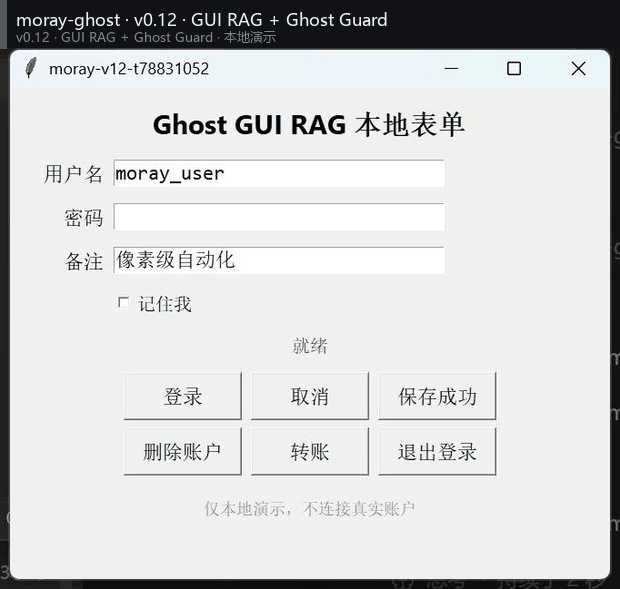
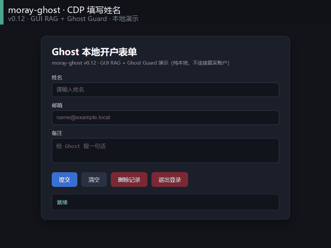
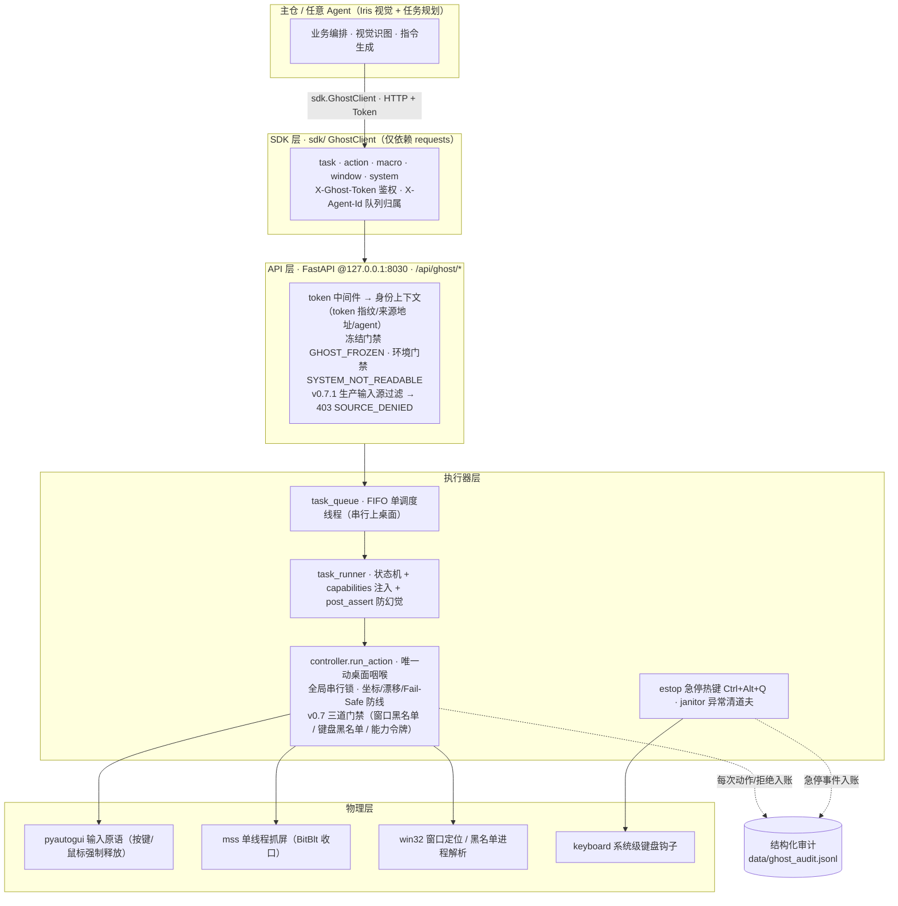

# moray-ghost


Windows 桌面自动化本地服务（v0.15.0）：**mss 极速截图 + 授权式 pyautogui 动作 + 宏录制/安全重放 + 任务生命周期 + 环境感知 + 视觉反哺 Heal + 多 Agent 任务队列 + Web 监控面板 + 官方 Python SDK + MCP Server（Stdio，任意 AI Agent 即插即用，v0.14 起带 Resources 免工具看屏）+ 本地 VL 感知（rapidocr / llama-cpp CUDA GGUF，2B/7B 档位 + CV+VL 混合图标定位）+ GUI RAG（OCR+CV 编号元素表 → VLM 只回 target_id）+ Ghost Guard（点击前动态高危词门禁 → PENDING_APPROVAL / 人工审批令牌）+ 纯鼠标平滑绘制 draw_trajectory + v0.7 绝对防御 + v0.7.1 企业级安全 + v0.7.2 极限安全 + v0.14 多屏混合 DPI 坐标对齐与长时挂机保障 + v0.15 快慢双系统（System1 弹窗反射脑）/ 跨平台驱动抽象 app/platforms/ / 自我进化技能库（pynput 行为克隆 + VLM 语义标注）**。

> 📜 **[致开源社区的公开信（中英双语）](docs/OPEN_LETTER.md)** · 📦 **[v0.15.0 Release Notes](docs/RELEASE_v0.15.0.md)**

只监听 `127.0.0.1:8030`；绝不触碰 `D:\MoRay`（主仓）。

## 🎬 v0.12 实战实拍（GUI RAG + Ghost Guard，自建本地靶窗，绝不连接真实账户/微信）

| 原生 Tk 表单：RAG 选号填表 → 保存 → Guard 拦截删除 → 人工审批 | 本地浏览器表单：CDP 填表 → Guard 拦截删除/退出 → 人工审批 |
|---|---|
|  |  |

零坐标幻觉：控件 bbox 全部来自像素/句柄，VLM 只做选择题（回 `target_id`）；
10 控件召回 10/10、IoU 最小 0.965、中心误差 ≤0.5px。点击前 Ghost Guard
对落点控件做 OCR/DOM 高危词门禁，命中 → **409 PENDING_APPROVAL 零输入**，
人工审批令牌才放行（agent 不能自批）。

> **⚠️ v0.4.1 起全部接口统一挂载在 `/api/ghost/` 前缀下**（如 `/api/ghost/health`、
> `/api/ghost/execute_action`），主仓可在同一端口挂载自己的服务而互不冲突。
> 主仓对接请读 **[docs/Ghost主仓接入指南.md](docs/Ghost主仓接入指南.md)**，
> 对接链路可用 `scripts/mock_moray.py` 一键验证。
>
> **v0.5 平台化**：Ghost 升级为"所有 Agent 通用的桌面操控底座"——
> 任务级 FIFO 队列 + `X-Agent-Id` 状态隔离 + emergency stop 冻结 + `/dashboard`
> 监控面板 + `sdk/` 官方 Python 客户端（其他 Agent 零门槛接入，见 [sdk/README.md](sdk/README.md)）。
>
> **⚠️ v0.7 绝对防御（先上锁，再跑车）**：任何会打进窗口的输入必须携带能力令牌
> `capabilities.allowed_windows`（最小权限，缺失/越权 → 403 CAPABILITY_DENIED /
> 400 CAPABILITIES_REQUIRED）；窗口黑名单（cmd/powershell/pwsh/regedit/
> WindowsTerminal/conhost + 标题含 UAC/格式化/删除）与键盘黑名单（win 系热键 /
> ctrl+shift+esc / format·shutdown·格式化等破坏性文本）最高优先级拦截 →
> 403 HIGH_RISK_WINDOW / HIGH_RISK_INPUT；task 步骤可带 `post_assert` 后置断言
> （窗口标题 / cv2 锚点模板 / OCR 字样），断言未过 → 立刻 degraded 挂起并明示
> "指令可能错误"（防大模型幻觉）。拦截验证：`scripts/test_v07_redline.py` 40/40。
>
> **⚠️ v0.7.1 企业级安全与开源标准（物理级绝对控制）**：
> ① **单实例互斥**——启动即抢 Windows 命名互斥体 `Global\MorayGhostSingleInstance`
> + 端口预检，本机永远只能跑一个 Ghost（第二实例直接 `FATAL` 退出，锁随进程消亡
> 自动释放、无僵尸）；② **全局急停热键 Ctrl+Alt+Q**——`keyboard` 系统级钩子，
> 一按立刻释放全部按键鼠标 + 审计落盘 + `os._exit(1)`（网页大红按钮点不到时的
> 物理逃生口）；③ **`GHOST_ENV=production` 输入源过滤**——任何不来自带 Token 的
> 合法 HTTP 调用链（或其派发的任务）的动作一律 403 `SOURCE_DENIED`，进程内旁路
> 裸调 `run_action` 也被拒且零位移；④ **结构化审计**——每次动作/急停/清场写
> `data/ghost_audit.jsonl`（JSON Lines：何时 / 谁 / 哪个 token 指纹 / 坐标明细，
> 绝不落 token 原文）；⑤ **异常清道夫**——任务失败/取消/崩溃强制释放按键鼠标 +
> 线程盘点入审计（零杂散线程）。验收：`scripts/test_v071_security.py` **37/37**。
>
> **⚠️ v0.7.2 极限安全与物理自救（绝对不可逆灾难零容忍）**：
> ① **UAC 提权免疫**——目标是 `consent.exe` 或「用户账户控制」标题族窗口时，
> 任何动作直接 **FATAL**（403 `FATAL_UAC_ELEVATION`），先物理释放全部按键鼠标
> 再拒绝（零输入），审计落 `uac_fatal` 事件；② **独立看门狗**——
> `scripts/ghost_watchdog.py`（lifespan 自动拉起、DETACHED 独立进程、PID+创建
> 时间双校验防复用）：主进程被任务管理器强杀后，它用 `keybd_event` 物理释放
> Ctrl/Shift/Alt/Win 全部左右变体，键盘绝不卡死；③ **动作频率熔断**——同一
> 指纹 1 秒内 >10 次或连续重复 >50 次 → 429 `RATE_CIRCUIT_BREAK` + **强制冻结
> 服务**（`frozen_reason=rate_circuit_break` 经 dashboard/state 与全部 503 回包
> 通知主仓），release 解冻即重新武装；④ **动作硬超时**——锁等待与执行两段
> 各受 `GHOST_ACTION_TIMEOUT`（默认 10s）预算约束，超时 → abort 未开始的执行
> + 物理释放按键鼠标 + 冻结 + 408 `ACTION_TIMEOUT`（拖拽声明时长不计入预算，
> 合法长动作不误杀）；⑤ **健康检查解耦**——`/health`、`/emergency_stop`、
> `/dashboard/state` 全部 async 化（事件循环直跑、绝不排队等线程池），长动作/
> 页面加载占满线程池时急停按钮与探活依然即时；⑥ **控制台非阻塞**——服务
> stdout/stderr 从 FD 层置非阻塞，父进程不读日志管道时宁可丢日志也绝不卡死
> 服务（栈转储实证修复的整机假死死锁）；⑦ `GHOST_STACKDUMP_INTERVAL` 周期
> 线程栈取证。验收：`scripts/test_v072_extreme.py` **40/40**。
>
> **⚠️ v0.8.0 MCP 多模态感知底座（自带眼睛的通用外设）**：
> ① **VL Driver**（`app/core/vl_driver.py`）——截图/窗口 → 控件 JSON
> （文本/类型/物理像素 bbox/中心），四后端策略：`ocr`（rapidocr PP-OCR ONNX，
> 轻量级本地视觉模型，无权重管理即装即用）/ `native`（win32 枚举，零依赖）/
> `llama`（llama-cpp-python + `GHOST_VL_MODEL_PATH` GGUF 真模型，如
> Qwen2-VL-2B）/ `mock`（夹具）；`auto` 按 llama→ocr→native 如实降级并回显
> 真实出处；匹配铁律 0 命中 404、多命中 409 绝不猜；服务端收口
> `POST /api/ghost/vl/analyze`（需 token，走单一 capture 线程与进程内单例模型）。
> ② **MCP Server**（根目录 `mcp_server.py`，官方 `mcp` SDK Stdio）——4 个标准
> Tools（v0.9.1 起 5 个，新增 `draw_trajectory`）：`analyze_screen` / `click_element` / `type_text` / `execute_task`；
> **路由分流**：URL 或 Edge/Chrome 窗口 → CDP（by=text），原生 → VL 定位中心
> → 安全管道点击；身份与白名单启动时从环境注入（`GHOST_TOKEN` /
> `GHOST_AGENT_ID` / `GHOST_CAPABILITIES`），**tool 参数改不宽白名单**，
> 一切经 HTTP+Token 回服务端——令牌/能力令牌/黑名单/熔断/硬超时/审计 100% 生效。
> ③ **打字注入升级**：本机中文 IME 会把 `pyautogui.write` 的字母打成
> VK_PROCESSKEY（实证），ASCII 逐键注入切换为 `keyboard.write`（规范 VK+扫描码，
> 失败回落 pyautogui）。验收：`scripts/test_v08_mcp_vl.py` **21/21**。
> **真模型挂载**：GGUF 放 `models/`（已 gitignore）→ `.env` 设
> `GHOST_VL_MODEL_PATH` + `GHOST_VL_MMPROJ_PATH` → `auto` 自动切 llama；
> 下载链接（hf-mirror 实测存在）、Cursor/Claude Desktop 配置与排障见
> **[docs/MCP_接入指南.md](docs/MCP_接入指南.md)**。
> **像素级实证**：`scripts/test_v08_paint_precision.py` **11/11**——MCP 全链操作
> 系统画图（OCR 读出功能区 19 控件、拖拽经安全队列），笔迹 bbox 与意图逐边
> 误差 [2,2,4,3]px。
>
> **v0.9.0 GPU + 7B 档位 + 混合图标定位**：`llama-cpp-python 0.4.5+cu128`
> （CUDA 12.8 runtime/cuBLAS 由 pip 包提供），`/health` 回显
> `vl.gpu_offload=true`；2B 靶窗定向 TTFT 0.68–2.65s、总 2.8–5.1s（GPU），
> 无 OOM/掉卡；`.env` 用 `GHOST_VL_MODEL_PROFILE=2b|7b` 切档，7B 路径已预留。
> 混合定位 `app/core/icon_grid.py`：CV（Otsu+连通域）粗筛小图标 → 编号
> contact sheet → VL 选号 → 置信度门；定向 VL 结果再做 **OCR 标签复核**，
> 拒绝“看似合理但目标不存在”的 bbox。验收：MCP **21/21**、画图 **11/11**、
> 混合单测 **6/6**；**7B 实测**文本定位 1px/TTFT 2.17s，但无文字形状仍会把
> 直角矩形选成圆角/菱形（0.99），画图 9/11——混合定位因此默认关闭
> （`.env` `GHOST_VL_HYBRID=0`），下一步需 CV 形状校验/更强模型。
>
> **v0.9 纯鼠标绘画（无 VLM）**：`scripts/test_v09_draw_whale.py` **25/25**——
> 自建 Paint + PID 差集绑定，P 铅笔 + CV 蓝色色板 + Chaikin 平滑坐标轨迹，
> 画出鲸鱼（身体/尾鳍、眼睛、微笑、喷水、气泡、爱心、腹部线、胸鳍、海浪），
> 截图 `data/screenshots/whale_art.png`。底层 `move_to` 从 `SetCursorPos`
> 改为 **`mouse_event` 绝对移动**（私有 `user32` 句柄，避免污染 pyautogui），
> 画图/指针应用才能看到真实曲线；Fail-Safe 四角检查保留，v0.7.2 极限安全
> **40/40** 复验。MCP **21/21**、画图 **11/11** 同步回归；`vl_driver` 在
> auto 模式下 llama 控件 ≤1 条时用 OCR 补全控件表（`timings.ocr_merged`）。

> **v0.9.1 通用绘制接口 + VLM 读图闭环**：鲸鱼的"平滑 + 降采样 + 真实鼠标事件"
> 沉淀为底座资产 **`draw_trajectory(points, color)`**——服务端
> `app/core/trajectory.py`（Chaikin 平滑 + ≤2000 点等距降采样 + HSV 色板定位）
> + 复合端点 `POST /api/ghost/draw_trajectory`（取色点击与落笔两段都走
> `run_action` 同一安全管道：冻结/环境门禁前置、归属门禁/逐点 Fail-Safe/
> 硬超时/审计全生效；色板未找到 `color_required=true` → 404，否则如实
> fallback）；SDK `client.draw.trajectory(...)`；**MCP 第 5 个工具**
> `draw_trajectory`。验收 `scripts/test_v09_draw_trajectory.py` **31/31**
> （单元 11 + 契约 9 + Paint 真绘端到端 8：色板命中并点击、1333 笔迹像素全蓝）。
> **VLM 读自己的画**：新增 `POST /api/ghost/vl/describe`（自由问答式读图，
> 支持直接喂 image_b64——主仓 Iris 可发自己的截图/裁剪图），
> `scripts/test_v09_vlm_read_whale.py` **4/4**：Qwen2-VL-2B 看着鲸鱼画作
> 答"一条鱼""蓝色的""水花、爱心、海浪、泡泡"（鱼级而非鲸级 = 2B 真实能力
> 边界，如实记录）。**踩坑沉淀**：`docs/底层物理控制.md`——SetCursorPos 不
> 触发轨迹 / ctypes 签名污染毒死 pyautogui / 画图软件合并闭合线。官方封面
> `docs/assets/whale_cover.html`（轨迹重放动画 + 真实截图，自包含单文件，
> `scripts/make_whale_cover.py` 再生成）。
>
> **v0.12.0 GUI RAG + Ghost Guard（让 VLM 做选择题，不做坐标题）**：
> ① **检索层** `vl_driver.extract_ui_elements()`——客户区截图经
> **OCR 文本 + OpenCV 矩形 + win32 原生几何**三方合并，产出带编号的元素表
> （id/标签/类型/物理像素 bbox/中心/输入值/危险标记）。bbox 全部来自像素或
> 句柄，**模型永远不生成坐标**，从根上消除坐标幻觉；Tk 的 Win32 text 恒为空，
> 由 OCR 补标签、原生 class 补角色（input/button/checkbox），CV 边框把
> TkChild/按钮 bbox 精修到 ≤1px。检索结果短 TTL 缓存，动作后立即失效。
> ② **选择层** `vl_driver.ground_target()`——文本精确命中走零模型快路径；
> 模糊目标把编号目录（必要时附编号截图）交给本地 Qwen2-VL，只要求
> `{"target_id": N}`。2B GPU 目录选号 ~0.4s/次；10/10 标签全对，
> 选中 bbox 与检索表逐字节一致。服务端新增
> `POST /api/ghost/vl/elements`（编号元素表）与 `POST /api/ghost/vl/ground`
> （query → target_id → 真实 bbox）；MCP `click_element` 默认先走 GUI RAG，
> 未命中再回落到既有 analyze/target/hybrid 路径，5 个 Tools 白名单不变。
> ③ **Ghost Guard 动态门禁**——`safety_gate.dynamic_guard()` 对 OCR/DOM 文本
> 做高危词检测（转账/付款/删除/移除/格式化/退出登录/注销/卸载/重置…）；
> 原生点击在 `moveTo` **之前**，先用 before 截图的 CV 矩形定位落点控件、
> 只 OCR 控件内部文本（避免把相邻「删除」读成当前目标），命中 →
> **409 PENDING_APPROVAL，零输入**；配置 `GHOST_APPROVAL_TOKEN` 后，payload
> 带匹配 `approval_token` 才放行并审计 `guard_approved`。OCR 不可用时默认
> fail-closed（503 `VISUAL_GUARD_UNAVAILABLE`）。CDP 浏览器点击同样检查
> 目标 DOM 文本（`source=cdp_dom`）；**MCP Agent 环境不读取/不透传审批令牌，
> agent 不能自批**。配置与边界见 `.env.example` / `docs/v0.12-design.md`。
> ④ **准确率与实战**：`scripts/test_v12_gui_rag.py` **44/44**——10 个真实
> 控件召回/精确率 **10/10**，bbox IoU 最小 **0.965**、平均 **0.974**，
> 中心误差最大 **0.5px**；VLM 选号 **10/10**（含「登录 vs 退出登录」消歧、
> 中文模糊目标「保存」「密码框」）；Guard 拦截/错误令牌/正确审批令牌/审计
> 全链路通过。`scripts/test_v12_heavy_gui.py` **28/28**——自建 Tk 表单
> 由 RAG 选号填入 `ghost_agent` / `gui-rag-ok` 并保存（标题回显），删除账户
> 先 409 后审批 200；自建 headless Edge + 本地 HTML 表单 CDP 填表/提交，
> 删除记录与退出登录均先 409、审批后生效。原生 3fps 录屏 + 浏览器 CDP
> 页面帧录制：
> **[gui_rag_form_guard.gif](docs/assets/gui_rag_form_guard.gif)**（桌面原生）、
> **[browser_form_guard.gif](docs/assets/browser_form_guard.gif)**（页面级 CDP），
> 附 MP4 与最终 PNG。**回归**：MCP+VL **21/21**、Paint 像素精度 **11/11**、
> CDP 浏览器 **14/14**、极限安全 **40/40**、draw_trajectory **31/31**。
> **踩坑沉淀**：Edge 同步弹窗会盖住系统级录屏 → 浏览器 GIF 改用 CDP
> 页面截图；`taskkill /T` 杀不到重挂载的 Edge 窗口宿主 → 以临时
> `--user-data-dir` 指纹精确杀整棵树。
>
> **v0.15.0 AGI 物理躯体三大进化（快慢双系统 / 跨平台抽象 / 自我进化）**：
> ① **System1 微型反射脑**——`require_vision` 挂起前，本地 OCR 规则库
> （特征词「软件更新/广告/隐私协议/每日提示…」× 关闭类按钮「关闭/×/稍后/
> 同意…」同窗 AND 命中，按钮按安全优先级排序、同意永远最后）直接本地
> 点击消解，任务继续不返 degraded；UAC/黑名单窗口在 OCR 之前零输入拒绝；
> `GHOST_SYSTEM1_AUTO_DISMISS` 一键开关；**47/47**。
> ② **跨平台驱动抽象**——`app/platforms/`：BaseScreen/BaseInput 契约 +
> Windows 真身全量迁入 + macos/linux NotImplementedError 骨架（绝不假装
> 能跑）+ 按 `sys.platform` 动态加载；`core/screen_mss.py`、`core/backend.py`
> 变再导出 shim（全量 `is` 同一性 = 单一模块状态零分裂，旧引用零回归）；
> **21/21** + v14_dpi 20/20 + v072 40/40。
> ③ **自我进化技能库（行为克隆）**——pynput 全局静默录制点击/打字/滚动
> （回调只入队微秒级返回，BitBlt 重活独立线程——阻塞钩子线程会拖死注入
> 输入链）+ 点击现场帧 + VLM 逐点击语义标注 target_text（llama 不可用
> 诚实降级：原始坐标 + 低置信度）+ SQLite 技能表 + `/skill/*` 六端点 +
> 回放走 run_action 全门禁（`continue_on_error` 噪声容忍：人类鼠标噪声被
> 能力白名单零输入拒绝）；**28/28**。顺手修产品级隐患：OCR ONNX 冷启动
> 15-25s 会顶穿首击硬超时 → 服务启动后台预热。
>
> **v0.14.0 极致鲁棒性与跨环境适配（开源工业级底座的恶劣环境压力位）**：
> ① **多屏与混合 DPI 坐标对齐**——DPI 感知收口到新模块
> `app/core/dpi_awareness.py`：Per-Monitor V2 首选 + shcore HRESULT 严格
> 检查 + 系统级兜底，修掉旧 `except OSError` 永不触发、进程"以为自己 DPI
> 感知了"而在 150%+100% 双屏下静默 ×1.5 错位的根因；`backend.move_to`
> 绝对归一化后追加**相对事件像素级修正**（多屏 8K 级虚拟桌面 0..65535
> 归一化量化误差 >1px 时仍精确落点，且仍是真实鼠标事件、画图语义不变），
> 越界坐标显式 `ValueError`（拒绝"静默钳到另一块屏"）；`/environment`
> 新增 DPI 档位 / 各屏物理矩形 / 虚拟桌面一致性自检。
> 验收 `scripts/test_v14_dpi.py` **20/20**：软件模拟单/双/三屏布局的归一化
> 往返、源图缩放换算、非感知错位复现实证（+999px）；实机每屏 3×3 网格
> move→读回 **0px 误差**；自建 Tk 靶窗「服务端截图像素反推 bbox →
> `/execute_action` 真实点击 → Tk 事件坐标」全链 **drift 1px**。
> ② **长时挂机资源保障**——`scripts/test_v14_stress.py` analyze_screen /
> draw_trajectory 各 100 次（draw 全部落在自建靶窗内），每 10 次打印服务端
> GDI/USER 句柄、RSS、nvidia-smi 显存、截图文件数；**发现并修复**审计截图
> 无界累积（实测 13,594 张 / 3.4GB，挂机数周必撑爆磁盘）→
> `GHOST_SHOT_MAX_FILES` 按 mtime 修剪（默认 2000，0=关闭）。泄漏判据：
> warmup 基线 vs 收尾 ΔGDI/USER ≤ +30、ΔRSS ≤ +120MB、ΔGPU ≤ +256MB。
> ③ **MCP Resources（官方规范只读资源）**——`screen://current`（实时主屏
> JPEG，物理像素与 bbox 同一坐标系）+ `ui://elements`（GUI RAG 编号元素表
> JSON）：客户端 AI **不调工具就能"看到"当前环境**，规划循环省一轮工具
> 往返；只读端点、冻结期照常可用、与 Tools 同一 token 鉴权，
> 截图编码走 `GHOST_MCP_SCREEN_SCALE` / `GHOST_MCP_SCREEN_QUALITY`。
> 验收 `scripts/test_v14_mcp_resources.py` **8 checks**（握手 / 列表 /
> blob 魔数与物理分辨率 / 元素表靶窗命中 / 工具回归 / 未知资源错误路径）。

## ⚠️ 测试纪律红线（所有脚本强制执行，违反即事故）

> 起因：2026-10-24 验收时测试脚本曾以"标题匹配取第一个窗口"的方式定位记事本并关闭，
> 且会话恢复把用户工作文件的标签页载入了测试窗口并出现在证据截图里——**越界，已整改**。

1. **禁止侵入用户桌面**：测试/验收脚本需要 GUI 靶子时，必须 `subprocess.Popen` 自己
   新开窗口，并用 **hwnd 差集绑定**（启动前快照全部 hwnd → 只允许操作新增 hwnd）。
2. **禁止复用已有窗口**：`list_windows()` 结果里既有的 hwnd 一律不碰，无论标题是什么。
3. **操作已有窗口必须用户明确授权**：操作前记录 rect，操作后 `SetWindowPos` 还原；
   无授权即禁止。
4. **关闭验证只认"自己开的 hwnd 已消失"**，不得以"桌面上没有 XX 窗口了"作为通过依据。
5. **证据链**：测试输出必须打印自己创建的 hwnd 及其销毁结果；不得引用/展示用户窗口内容。

## 架构总览

### 架构图（Mermaid：主仓 → SDK → API → 执行器 → 物理层）



### 分层细节（文本版）

```
主仓 / 任意 Agent（Iris 视觉 + 任务规划）
   │
   │  sdk.GhostClient（sdk/，仅依赖 requests，拷走即用）
   │    client.task.run() / action.click() / macro.heal() / system.emergency_stop()
   │    请求头：X-Ghost-Token（鉴权） + X-Agent-Id（队列归属）
   ▼
HTTP 层   FastAPI @ 127.0.0.1:8030，全部接口挂 /api/ghost/ 前缀
   │      token 中间件 · 冻结门禁（GHOST_FROZEN） · 环境门禁（锁屏/UAC → 503 SYSTEM_NOT_READABLE）
   ▼
任务队列  app/core/task_queue.py（v0.5）
   │      FIFO 单调度线程串行派发：created → queued → running → done | degraded | canceled
   │      X-Agent-Id 状态隔离（跨 Agent → 403 AGENT_FORBIDDEN） · queue_position 排位
   │      emergency stop：清空队列 + 冻结（/dashboard 同款大按钮）
   ▼
任务执行器  app/core/task_runner.py
   │      步骤：action / macro / wait / require_vision（v0.7：capabilities 强制注入 +
   │      post_assert 后置断言——断言未过 → degraded「指令可能错误」，防幻觉）
   │      任一步失败 → degraded 挂起（fail 快照 + 现场截图，等主仓处置）→ resume 从失败步重排队
   ▼
统一安全管道  app/core/controller.py + safety_gate.py（v0.7 绝对防御）
   │      全局动作串行锁 · 坐标防线（越界/Fail-Safe 角点/漂移>3px） · Fail-Safe 常开 · 前后审计截图
   │      v0.6：drag 平滑轨迹（起点+终点归属门禁、逐点 Fail-Safe、finally 强制释放鼠标键）
   │            scroll 平滑分片（作用点归属门禁） · 动作日志入账点（input_audit 同咽喉）
   │      v0.7：窗口黑名单（cmd/Terminal/UAC/格式化/删除…→ 403 HIGH_RISK_WINDOW，锁前早杀+锁内落点复核）
   │            键盘黑名单（win 系热键/format/shutdown…→ 403 HIGH_RISK_INPUT）
   │            能力令牌（目标进程 ∉ allowed_windows → 403 CAPABILITY_DENIED，最小权限）
   ▼
执行后端  backend.py（pyautogui 输入 + mouse_down/up/scroll 原语）
   │      screen_mss.py（mss 单线程抓屏） · window_locator.py（win32）
   ▼
网页通道（v0.6 M2） app/core/browser_driver.py（playwright connect_over_cdp）
          只连本地调试端口（GHOST_BROWSER_CDP_URL，默认 127.0.0.1:9222，禁 bundled browser）
          元素定位 role/text/css/placeholder/label/testid；多候选未给 nth → 409 绝不猜
          冻结门禁 / input_audit(channel=cdp) / ACTION_LOCK 与原生通道同级

观测面：GET /dashboard（任务轮播 + 实时动作日志 + 实时抓图 + EMERGENCY STOP）
        GET /api/ghost/dashboard/state · GET /api/ghost/actions/recent（+ /actions/thumb/{name}）
反哺面：POST /api/ghost/macro/{id}/heal（主仓 Iris 视觉回填锚点，乐观锁 version）
```

## 安全模型

- **token 鉴权**：所有执行动作接口（`/execute_action`、`/macro/*`）强校验请求头
  `X-Ghost-Token`，缺失或不匹配一律 401，动作不执行。`/health`、`/screenshot`
  为探活放行。
- **Fail-Safe 常开**：`pyautogui.FAILSAFE=True` 硬编码、无开关。鼠标甩到屏幕角落
  立即中止整个动作/宏 → HTTP 409 + 现场截图。
- **审计无盲点**：任何动作执行前、后各拍一张全分辨率截图落盘
  （`data/screenshots/`），并随响应返回路径。
- **全局串行**：桌面动作持进程内锁串行执行（宏重放 v0.3 也必须走同一管道）。
- **任务队列（v0.5）**：任务（`/task/*`）经单调度线程按 FIFO 串行上桌面，状态机
  `created → queued → running → done|degraded|canceled`；直接调 `/execute_action`
  的零散动作仍走底层锁。
- **紧急冻结（v0.5）**：`POST /api/ghost/emergency_stop` 清空队列 + 冻结，
  冻结期 start/resume/execute_action/宏重放/browser action 一律 503 `GHOST_FROZEN`；
  `POST /api/ghost/emergency_stop/release` 解冻。
- **坐标防线**：越界 / 落入 Fail-Safe 角落（保护半径 2px）/ moveTo 后漂移 >3px
  一律 400 `SAFETY_BLOCKED`；drag 轨迹逐点复核（落角中途 mouseUp，绝不留按住态）。
- **动作审计（v0.6）**：`controller.run_action` 是唯一动桌面咽喉，每次真实输入记
  `input_audit`（ghost.log）；HTTP 层全量落 `logs/access.log`（来源/方法/路径/状态码）；
  驾驶舱动作日志（内存环 200 条）含执行后缩略图，冻结期被拒动作同样入账。
- **DPI 感知**：Windows 下在 `import mss` / `import pyautogui` 之前调用
  `SetProcessDpiAwareness(2)`，保证截图分辨率与点击坐标一致（物理像素）。
- **mss 实例管理**：BitBlt 抓屏全部收口到单一专用 capture 线程（一个 mss 实例、
  队列化、失败自愈 + 退避重试）。实测多线程各自持 mss 实例时 BitBlt 会间歇性
  失败（拒绝访问/no error），单线程收口彻底消除，同时满足"禁止请求线程反复
  new mss（GDI 句柄泄漏）"红线；`monitors()` 枚举保留 thread-local 缓存。
- **token 来源**：只从 `.env`/环境变量读取；缺失时首次启动生成随机 token 写回
  `.env`（已 gitignore），源码与示例中不含可用凭据。
- **单实例互斥（v0.7.1）**：`run.py` 启动先抢 Windows 命名互斥体
  `Global\MorayGhostSingleInstance`（`CreateMutexW`，机器级唯一）+ 8030 端口预检，
  任一被占直接 `FATAL` 报错退出——本机永远只有一个 Ghost 持有桌面输入；互斥体
  句柄随进程消亡由内核自动释放，强杀也不会留下僵尸锁。`app/main.py` lifespan
  兜底（直接 `uvicorn app.main:app` 启动同样受门禁）。
- **全局急停热键（v0.7.1）**：`keyboard` 系统级钩子注册 **Ctrl+Alt+Q**
  （`GHOST_ESTOP_HOTKEY` 可改，留空禁用；不抑制组合键、不影响其他程序），
  按下即：强制释放全部按键与鼠标键 → 审计同步落盘 `estop_hotkey` →
  `os._exit(1)` 进程级退出（绝对服从物理断电）。注册失败只告警不阻断服务。
- **生产环境输入源过滤（v0.7.1）**：`GHOST_ENV=production` 时，动作必须来自
  带 Token 的合法 HTTP 调用链（中间件写入的身份上下文，`source=http_api`）或
  其派发的任务队列（`source=task_queue`）；进程内裸调 `run_action` 等旁路一律
  403 `SOURCE_DENIED`（先于一切校验、零位移）。默认 `dev` 宽松，旧联调行为不变。
- **结构化审计落盘（v0.7.1）**：`data/ghost_audit.jsonl`——一行一个 JSON 对象
  （`service_start/stop`、`action` 成功与被拒、`emergency_stop/release`、
  `estop_hotkey`、`sweep`、`task_end`），动作记录带身份三元组：何时（ts）、
  谁（client 来源地址 + agent_id）、用什么 Token（`token_fp` = sha256 前 12 位
  指纹，**绝不落 token 原文**）；单文件 10MB 自动轮转；线程安全、写失败只告警
  不打断业务。
- **异常线程清道夫（v0.7.1）**：任务失败/degraded/取消/崩溃 → `janitor.sweep`
  强制释放全部按键鼠标（`release_all_modifiers` + `release_pointer_buttons`，
  幂等）+ 线程盘点（与启动基线比对，杂散线程名单入审计）；controller 动作级
  失败路径（Fail-Safe / ActionError / 未预期异常）同样清场——绝不把"按住"状态
  泄漏给系统。

## 快速开始

```powershell
.\start.ps1                                   # 首次运行自动建 .venv 装依赖并启动
.venv\Scripts\python scripts\smoke.py         # 冒烟：health / screenshot / 401 / macro 占位
.venv\Scripts\python scripts\smoke.py --failsafe   # 追加：Fail-Safe 409 现场测试
.venv\Scripts\python scripts\test_v071_security.py # v0.7.1 安全验收（互斥/热键/审计/生产过滤）
.venv\Scripts\python scripts\test_v072_extreme.py # v0.7.2 极限安全验收（UAC/看门狗/熔断/硬超时）
.venv\Scripts\python scripts\test_v08_mcp_vl.py   # v0.8.0 MCP+VL 验收（Stdio/感知/点击/门禁透传）
.venv\Scripts\python scripts\test_v08_paint_precision.py  # 画图工具像素级精度综合（11 checks）
.venv\Scripts\python scripts\test_v12_gui_rag.py  # v0.12 GUI RAG 精度 + Guard 全链路（44 checks）
.venv\Scripts\python scripts\test_v12_heavy_gui.py # v0.12 重型实战：Tk/浏览器填表 + 录制 GIF（28 checks）
.venv\Scripts\python scripts/test_v14_dpi.py      # v0.14 多屏/混合 DPI 坐标一致性（20 checks）
.venv\Scripts\python scripts/test_v14_stress.py   # v0.14 长时压测：analyze/draw 各 100 + 资源采样
.venv\Scripts\python scripts/test_v14_mcp_resources.py # v0.14 MCP Resources 协议（8 checks）
.venv\Scripts\python mcp_server.py                # 以 Stdio 方式作为 MCP Server 供 Agent 拉起
# Cursor / Claude Desktop 接入：docs/MCP_接入指南.md（含模型下载链接与放置路径）
# v0.12 设计/边界：docs/v0.12-design.md
```

冒烟脚本会把鼠标甩到屏幕左上角再还原（`--failsafe` 时）；`--no-click` 可跳过真实点击。

> **急停**：网页 `/dashboard` 大红按钮，或随时按 **Ctrl+Alt+Q**（系统级热键，
> 一按进程立刻退出并释放全部按键鼠标）。**单实例**：重复启动第二个实例会直接
> `FATAL` 退出（互斥体 + 端口双门禁）。

## 接口契约（v0.2）

### GET /health（免 token）

```json
{"status":"ok","service":"moray-ghost","version":"0.15.0","fail_safe_enabled":true,
 "token_required":true,"backends":{"screenshot":"mss","input":"pyautogui"},
 "monitors":[{"index":1,"left":0,"top":0,"width":2560,"height":1440,"primary":true}],
 "cursor":[x,y],"db_path":"...\\data\\ghost.db",
 "guard":{"enabled":true,"mode":"block","fail_closed":true,
          "approval_token_configured":false,"version":"v0.12"},
 "rag":{"max_candidates":16,"min_conf":0.0,"image_mode":"auto","cache_seconds":2.0}}
```

### GET /screenshot（免 token）

query：`monitor=1|0|all`（0=全屏联合区，all=各屏数组）、`fmt=png|jpeg`、
`quality=10..95`、`scale=0.1..1.0`、`save=true|false`

```json
{"ok":true,"monitor":1,"monitor_origin":[0,0],
 "original_width":2560,"original_height":1600,"width":1280,"height":800,
 "format":"jpeg","scale":0.5,"screenshot_path":"...\\after.jpg",
 "cursor":[x,y],"elapsed_ms":24,"image_b64":"..."}
```

`original_width/height` 为真实屏幕尺寸，`width/height` 为缩放后尺寸；`monitor=all` 返回 `{"ok":true,"monitor":"all","shots":[每屏一条同构记录],"elapsed_ms":...}`。

### POST /execute_action（必须 `X-Ghost-Token`）

```json
{"action":"click|double_click|right_click|move|type|hotkey",
 "x":800,"y":500,"text":"hello","monitor":1,
 "settle_seconds":0.3,"include_before_b64":false,
 "fmt":"jpeg","quality":70,"scale":0.5,
 "source_width":1280,"source_height":800}
```

- `source_width/height` 可选（须同时给出）：给出时 x/y 视为缩放源图上的坐标，服务端换算为
  物理像素（400 `BAD_SOURCE_SIZE`：源尺寸非法或大于屏幕）；缺省时 x/y 即物理像素，行为不变。
- 精度：非整数倍缩放时换算精度为 ±1px（round 取整），需要亚像素精度请传 source_width = original_width（即不缩放）。
- 200：`{ok, action, executed_at, cursor_before, cursor_after, x, y, coord_source
  ("physical"|"scaled"), resolved_physical, monitor, monitor_origin,
  before_screenshot_path, after_screenshot_path, elapsed_ms, after_image_b64, before_image_b64?}`
- 401 `UNAUTHORIZED`：token 缺失/错误
- 403 `SOURCE_DENIED`：`GHOST_ENV=production` 且动作不来自带 Token 的 HTTP 调用链
  （进程内旁路裸调才会命中；正常 SDK/HTTP 调用不受影响）
- 400 `SAFETY_BLOCKED`：坐标越界 / 落入 Fail-Safe 角落 / 鼠标漂移 >3px
- 409 `FAIL_SAFE_TRIGGERED`：用户甩鼠标到角落，附 `scene_screenshot_path` +
  `scene_image_b64` 现场截图
- `hotkey` 的 x/y 可省略；`type` 前会把光标 moveTo 到 (x,y) 并做漂移校验
- **v0.12 Ghost Guard**：click/double_click/right_click 在 `moveTo` 前对落点
  控件做局部 OCR；命中高危词 → **409 `PENDING_APPROVAL`**（`hits` /
  `requires_approval` / `approval_token_configured` / `visual_guard`，动作零输入）。
  payload 带 `approval_token` 且匹配 `GHOST_APPROVAL_TOKEN` 才放行；成功后
  响应带 `visual_guard.verdict=approved`。OCR 不可用且
  `GHOST_GUARD_FAIL_CLOSED=true` → 503 `VISUAL_GUARD_UNAVAILABLE`。

### GUI RAG（v0.12，必须 `X-Ghost-Token`）

#### POST /api/ghost/vl/elements

把原生窗口客户区检索成**带编号的元素表**（OCR 文本 + OpenCV 矩形 + win32
原生几何三方合并；bbox 全部来自像素/句柄，不含模型坐标）。

```json
{"window":"无标题 - 记事本","monitor":1,"backend":"auto",
 "include_icons":false,"max_elements":200,"annotate":false}
```

```json
{"ok":true,"backend":"rag_ocr_cv",
 "window":{"hwnd":123456,"title":"...","process":"notepad.exe"},
 "elements":[
   {"id":2,"text":"用户名","type":"input","label":"用户名","value":"moray_user",
    "bbox":[484,372,365,31],"center":[666,387],"sources":["cv","native"]},
   {"id":9,"text":"保存成功","type":"button","bbox":[776,607,131,54],
    "center":[841,634],"sources":["cv","native"]}
 ],
 "count":13,
 "guard":{"verdict":"pending_approval","requires_approval":true,
          "dangerous_ids":[10,11,12],
          "hits":[{"token":"删除","category":"deletion","text":"删除账户",
                   "element_id":10}]},
 "timings":{"ocr_ms":214,"cv_ms":4,"assemble_ms":2},
 "annotated_b64":"<可选：编号截图 PNG>"}
```

#### POST /api/ghost/vl/ground

```json
{"query":"保存成功","window":"...","strategy":"auto",
 "match":"auto","use_image":null,"max_candidates":16,"annotate":false}
```

```json
{"ok":true,"method":"text_exact|text_contains|vlm_text|vlm_image|text_fallback",
 "target_id":9,
 "element":{"id":9,"text":"保存成功","type":"button","bbox":[776,607,131,54],
            "center":[841,634],"sources":["cv","native"]},
 "candidates":[{"id":9,"text":"保存成功","type":"button"}],
 "target_guard":{"requires_approval":false,"hits":[],"dangerous":false},
 "requires_approval":false,
 "elapsed_ms":18}
```

- `strategy=auto`：唯一精确/包含文本命中 → 零模型返回；否则 VLM 选号。
  `vlm` 强制选号（准确率验收用）；`text` 只做确定性匹配（多命中 409）。
- VLM 只回 `{"target_id": N}`，服务端把 N 映射回检索表的真实 bbox；
  不存在/越界/低置信 → 404 `VL_ELEMENT_NOT_FOUND`，绝不猜。
- 元素检索有 2s 短 TTL 缓存（连续选号免重复 OCR），任何动作后立即失效。

### 宏系统（骨架）

| 方法 | 路径 | 状态 |
|---|---|---|
| GET | /macro | 已可用（读 SQLite，初始返回空数组） |
| GET | /macro/{id} | 已可用（404 或详情） |
| POST | /macro/record/start | 已可用（`{"task_id":"..."}`；录制期间 execute_action 自动追加步骤） |
| POST | /macro/record/stop | 已可用（`{"task_id","name","app_signature"}`；写库返回 macro_id） |
| POST | /macro/{id}/replay | 已可用（dry_run / allow_fallback / task_id） |
| POST | /macro/{id}/heal | 501（主仓回填修补锚点） |

录制语义：`/execute_action` 请求新增可选 `hwnd`（录制提示）；每个成功动作自动
追加步骤——click 系动作锚点取自**动作前**审计截图（64x64，重放匹配的是点击前
的样子），type/hotkey 记 text 与录制时中心点。steps_json 结构：
`{"step_id","action","hwnd","target":{"type":"anchor|none","image_b64","recorded_center"},"text","wait_after_ms"}`。

重放语义（每步管道）：窗口存活（实时 get_rect，409 `WINDOW_NOT_FOUND`）→
click 在窗口 ROI 内匹配锚点（匹配成功才产生坐标，**绝不使用 recorded_center
推算**）→ 走 `controller.run_action` 同一安全管道（Fail-Safe/锁/前后审计截图）。
`not_found` → 409 `MACRO_NOT_FOUND`（附 best_score + 现场截图，终止整个宏，
交主仓重新识图；allow_fallback 为保留字段，当前不做任何兜底）；
抓屏失败重试 2 次后 → 503 `CAPTURE_FAILED`。`dry_run=true` 只出匹配报告。
每条 run 写 `macro_runs`（run_id/steps_ok/fail_step_index/fail_reason/fail_screenshot_path）。

所有 `/macro/*` 同样强校验 `X-Ghost-Token`（无 token 先 401）。重放落地时必须走
`app/core/controller.py` 的同一安全管道。存储：`data/ghost.db`（macros /
macro_runs / used_nonces 三张表，全部参数化查询）。

#### GET /window/list（需 token）

```json
{"ok": true, "windows": [{"hwnd": 123456, "title": "无标题 - 记事本",
  "class_name": "Notepad", "rect": [l,t,r,b], "is_minimized": false,
  "is_foreground": true}], "elapsed_ms": 3}
```

已排除：最小化、不可见、WS_EX_TOOLWINDOW 工具窗、零尺寸、无标题辅助表面。
rect 为物理像素 `[l,t,r,b]`（GetWindowRect 原值，不收敛到屏幕边界）。

#### POST /macro/probe（锚点匹配查询，只读，不执行任何动作）

请求：`{"screenshot_crop":"<base64 PNG（物理像素裁剪）>","match_threshold":0.8,"monitor":1,"window_hwnd":null}`

`window_hwnd` 可选：给出时**当次实时**取该窗口 rect 作为 ROI（每次重拿、绝不缓存——
用户会拖窗口），只在窗口内匹配。无 `window_hwnd` 时行为与旧版完全一致。

四态响应（**抓屏失败 ≠ 匹配失败 ≠ 窗口不存在**）：

- 200 `{"ok":true,"status":"matched","center":[x,y],"score":0.93,"bbox":[x,y,w,h],
  "matched_in_window":true,"roi_used":[l,t,r,b],"find_ms":38,"elapsed_ms":...}`
  —— center 为**全屏物理像素**（无论是否用窗口 ROI），可直接喂 `/execute_action`
  （不带 source_width）；`find_ms` 为 find() 内部耗时（抓屏之外）
- 200 `{"ok":true,"status":"not_found","best_score":0.42,...}`
  —— 抓屏成功但搜索区内没有锚点，这才允许降级让主仓重新识图
- 503 `{"ok":false,"status":"capture_failed","error":"...","elapsed_ms":...}`
  —— 抓屏本身失败，主仓应重试当前步骤，绝不降级识图
- 409 `{"ok":false,"error":"WINDOW_NOT_FOUND","status":"window_not_found","detail":"..."}`
  —— 指定的 hwnd 无效/最小化/零尺寸，主仓应恢复窗口后重试

坐标铁律：裁剪与匹配全程物理像素（scale=1.0），内部零缩放；锚点中心只决定
"在哪裁"，不参与匹配坐标计算，重放坐标一律来自匹配框中心。零方差（纯色）模板
会被直接判 not_found（TM_CCOEFF_NORMED 对其数学上无定义，实测会吐伪高分）。

鉴权支持两种 token：静态 token（默认），以及 `GHOST_INTENT_TOKEN_ENABLED=true`
时启用 HMAC Intent Token（`intent.<payload_b64>.<sig_b64>`，nonce 落
`used_nonces` 防重放）。

## 多 Agent 任务队列（v0.5）

请求头 `X-Agent-Id` 标识调用方（缺省 = 本机运维方，向后兼容旧脚本）：

- **FIFO 串行**：`POST /task/{id}/start`、`/resume` 进入全局队列，单调度线程按
  入队顺序派发；一个任务上桌面时其他任务排队等待。`GET /task/{id}` 返回
  `queue_position`（1-based 排位，非排队态为 null）与 `agent_id`。
- **状态隔离**：任务创建时记录归属。带【不同】agent id 访问他人任务 →
  403 `AGENT_FORBIDDEN`；不带请求头 = 运维方全量可见。
- **任务列表**：`GET /tasks?limit=50`——带 agent id 只见自己的任务，不带 = 全量。
- **冻结联动**：冻结期 start/resume → 503 `GHOST_FROZEN`；排队任务被
  emergency stop 清出时落 `canceled` + `fail_class=EMERGENCY_STOP`；
  running 任务在步骤边界安全点停止（绝不切断进行中的输入）。

## Web 监控面板（v0.5）

浏览器打开 `http://127.0.0.1:8030/dashboard`（单文件 HTML，无构建/无外部依赖）：

- **任务状态轮播**：running + queued 任务每 2 秒轮换展示（agent/task/状态/排位/步号）；
- **实时屏幕抓图**：每 5 秒拉一次 `/api/ghost/screenshot`（免 token，与探活同级）
  并标注抓取时刻与耗时；
- **EMERGENCY STOP**：巨型红色按钮，点击（需在面板填 token，存 localStorage）
  立刻清空任务队列并冻结 Ghost；冻结横幅 + 一键解冻。
- 数据源 `GET /api/ghost/dashboard/state`（免 token 只读快照）：frozen / queue_depth /
  running / queued。

## 官方 Python SDK（v0.5）

`sdk/` 目录，依赖仅 `requests`，其他 Agent 拷走即用（完整文档 [sdk/README.md](sdk/README.md)）：

```python
from sdk import GhostClient

client = GhostClient(agent_id="my-agent")     # token: 参数 > $GHOST_TOKEN > ./.env
client.environment.check()
client.action.click(1280, 720)
view = client.task.run(steps=[{"kind": "wait", "ms": 500}])   # 建+启+自动轮询
```

异常体系：`GhostError` 基类 → `GhostAuthError`(401) / `GhostForbiddenError`(403) /
`GhostFrozenError`(503) / `SystemNotReadableError`(503) / `TaskDegradedError`（带
`.task` 快照，处置后 `resume()` + `wait()`）/ `TaskTimeoutError` / `GhostConnectionError`。

根目录 `sdk_example.py` 是可跑通的全链路演示（体检/截图/单步动作/任务/degraded 处置）。

## 目录结构

```
app/main.py                 入口 + token 中间件 + lifespan + 调度线程装配
app/api/routes.py           /health /screenshot /execute_action
app/api/task_routes.py      /task/* + /tasks + /emergency_stop（v0.5）
app/api/dashboard_routes.py /dashboard 页面 + /dashboard/state（v0.5）
app/api/macro_routes.py     /macro/*（501 占位 + 只读列表/详情）
app/core/task_queue.py      任务 FIFO 调度器 + Agent 队列 + 冻结状态机（v0.5）
app/core/task_runner.py     任务状态机（created→queued→running→…）
app/core/config.py          .env、常量、DB 路径（v0.7.1：GHOST_ENV / 急停热键 / 审计路径）
app/core/screen_mss.py      thread-local mss + 编码 + 截图保留修剪（v0.14）+ 虚拟屏/DPI 自检
app/core/dpi_awareness.py   v0.14 进程 DPI 感知收口（Per-Monitor V2 / HRESULT 检查 / 档位如实上报）
app/core/backend.py         InputBackend 抽象 + PyAutoGUIBackend（v0.14 绝对+相对双段落点：归一化量化修正 + 越界拒绝）
app/core/controller.py      统一安全管道（锁 + Fail-Safe + 前后截图 + v0.7.1 输入源门禁 + v0.12 Ghost Guard 点击前局部 OCR）
app/core/safety_gate.py     安全红线（窗口/键盘/能力令牌）+ v0.12 dynamic_guard 动态高危词 + 审批令牌
app/core/auth.py            token 校验（静态 + HMAC Intent Token 可开关）
app/core/single_instance.py v0.7.1 单实例命名互斥体 + 端口预检（防多开）
app/core/authz.py           v0.7.1 调用来源/身份上下文 + 生产输入源过滤（SOURCE_DENIED）
app/core/audit_sink.py      v0.7.1 结构化审计落盘（data/ghost_audit.jsonl，token 指纹）
app/core/janitor.py         v0.7.1 异常清道夫（失败/取消释放按键鼠标 + 线程盘点）
app/core/estop.py           v0.7.1 全局急停热键 Ctrl+Alt+Q（释放输入 → 审计 → os._exit）
app/core/breaker.py         v0.7.2 动作频率熔断（窗口/连续双阈值 → 429 + 强制冻结）
app/core/vl_driver.py       v0.8.0 VL 感知（native/ocr/llama/mock 四后端 + 路由分流 + 匹配铁律；v0.9 GPU/OCR 标签复核；v0.9.1 describe；v0.12 GUI RAG 编号元素 + target_id 选号 + 检索缓存）
app/core/icon_grid.py       v0.9 CV 图标粗筛 + 编号 contact sheet（混合定位）
app/core/trajectory.py      v0.9.1 绘制资产：Chaikin 平滑 + 降采样 + HSV 色板定位
app/core/browser_driver.py  v0.6 CDP 浏览器接管（v0.12 DOM 文本 Ghost Guard + screenshot 录制原语）
app/api/vl_routes.py        v0.8.0 POST /vl/analyze（v0.9 target/hybrid；v0.9.1 + /vl/describe；v0.12 + /vl/elements /vl/ground）
app/api/draw_routes.py      v0.9.1 POST /draw_trajectory（取色+落笔复合动作，全安全管道）
mcp_server.py               v0.8.0 MCP Server（官方 SDK Stdio；v0.9.1 起 5 Tools；v0.12 click_element 优先 GUI RAG；v0.14 + Resources screen://current、ui://elements；身份/白名单环境注入）
scripts/ghost_watchdog.py   v0.7.2 独立看门狗（主进程被强杀后 keybd_event 释放修饰键）
scripts/test_v072_extreme.py  v0.7.2 极限安全验收：UAC/看门狗/熔断/硬超时（40 checks）
scripts/test_v08_mcp_vl.py  v0.8.0 MCP+VL 验收：Stdio/感知/点击/打字/任务/门禁（21 checks）
scripts/test_v09_hybrid_icons.py  v0.9 混合图标 CV/编号网格/开关矩阵单测（6 checks）
scripts/test_v09_draw_whale.py  v0.9 纯鼠标鲸鱼绘画全链路（25 checks）
scripts/test_v09_draw_trajectory.py  v0.9.1 通用绘制接口验收：单元/契约/Paint 端到端（31 checks）
scripts/test_v09_vlm_read_whale.py  v0.9.1 VLM 读自己的画（describe，4 checks）
scripts/test_v12_gui_rag.py   v0.12 GUI RAG 准确率 + Guard 拦截/审批 + MCP 全链（44 checks）
scripts/test_v12_heavy_gui.py v0.12 重型实战：Tk 表单 + 本地浏览器表单 + GIF/MP4 录制（28 checks）
scripts/test_v13_cad_stream.py v0.13 CAD 命令流替代验证：自建迷你 CAD 控制台 + 键盘命令流 + DXF/像素/VLM 三重验证（28 checks）
scripts/_v13_cad_console.py   v0.13 自建迷你 CAD 控制台靶窗（RECT/CIRCLE/ZOOM/SAVEAS 状态机 → ezdxf DXF）
scripts/test_v14_dpi.py       v0.14 多屏/混合 DPI：模拟换算 + 实机往返 + Tk 点击闭环（20 checks）
scripts/test_v14_stress.py    v0.14 长时压测：analyze/draw 各 100 次 + GDI/RSS/GPU/截图采样与泄漏判定
scripts/test_v14_mcp_resources.py v0.14 MCP Resources 协议验收（8 checks）
scripts/_v12_form_target.py   v0.12 自建 Tk 表单靶窗（10 控件，危险按钮仅本地回显）
scripts/make_whale_cover.py  v0.9.1 官方封面生成（docs/assets/whale_cover.html）
docs/底层物理控制.md         v0.9.1 物理层三大踩坑：SetCursorPos/ctypes 污染/闭合线合并
docs/v0.8-design.md         v0.8.0 vl_driver + mcp_server 设计结构（与实现同步）
docs/v0.12-design.md        v0.12 GUI RAG + Ghost Guard 设计/契约/准确率/踩坑
docs/MCP_接入指南.md         Cursor/Claude Desktop 接入 + 模型下载放置 + 排障
docs/assets/gui_rag_form_guard.gif    v0.12 原生 Tk 表单实战（RAG 选号/填表/Guard 拦截/审批）
docs/assets/browser_form_guard.gif    v0.12 本地浏览器表单实战（CDP 填表/Guard/审批）
scripts/test_v08_paint_precision.py  画图像素级精度综合（MCP 全链 + cv2 逐边对比）
app/core/macro_store.py     SQLite 读写 + schema 初始化
app/core/macro_runner.py    重放骨架（v0.3 落地）
sdk/                        官方 Python SDK（GhostClient，仅依赖 requests）
sdk_example.py              SDK 全链路演示
scripts/test_v071_security.py  v0.7.1 安全验收：互斥/审计/热键/生产过滤（37 checks）
scripts/test_v050_platform.py  v0.5 验收：队列/隔离/冻结/面板/SDK（零 GUI 靶子）
scripts/smoke.py            冒烟：health / screenshot / 401 / click / failsafe / macro
run.py  start.ps1  .env.example  requirements.txt（v0.7.1 全部 == 锁定）
```

## 已知限制（含 v0.12）

- `type` 的中文/emoji 支持：backend 检测到非 ASCII 文本时自动走**剪贴板粘贴**
  （pyperclip 备份 → 写入 → Ctrl+V → 还原/清空剪贴板；图片剪贴板无法经 pyperclip
  还原）。粘贴要求目标应用接受 Ctrl+V（记事本/常规编辑器验证通过；部分终端需
  Shift+Ins，未支持）。ASCII 文本仍走 pyautogui.write 逐键输入。
- `execute_action` 的 type/hotkey 带 `hwnd` 提示时执行**前台门禁**：目标窗口不在
  前台 → 409 `WINDOW_NOT_FOREGROUND`（与宏重放门禁对齐，绝不把文本打进别的应用）。
- 主屏（primary）判定采用虚拟屏 (0,0) 原点启发式（mss 不提供主屏标记）。
- `coordinates`/`screenshot` 返回的 `width/height` 为缩放后最终图像尺寸；
  审计落盘文件始终是全分辨率。
- **v0.12 GUI RAG 只支持原生窗口**：URL/Edge/Chrome 目标走 CDP，不跑
  `extract_ui_elements`；浏览器点击另有 DOM 文本 Ghost Guard。
- GUI RAG 的 10/10 召回/精确率是本机 10 控件 Tk 靶窗的实测，不代表任意
  界面；无边框扁平控件/纯图标工具条仍依赖 OCR 文本或 `include_icons`/旧
  hybrid 路径。2B 目录选号在复杂长目录上仍可能选错，服务端以 404 不猜兜底。
- Ghost Guard 只扫可见标签（原生：落点控件内部 OCR；CDP：目标 DOM 文本）；
  OCR 误读可能漏拦/误杀。拖拽起点不做过 OCR Guard（绘图性能取舍）；审批
  令牌是静态共享密钥（无 per-action nonce/TTL），安全边界依赖令牌保密 +
  审计 + 人工控制台。
