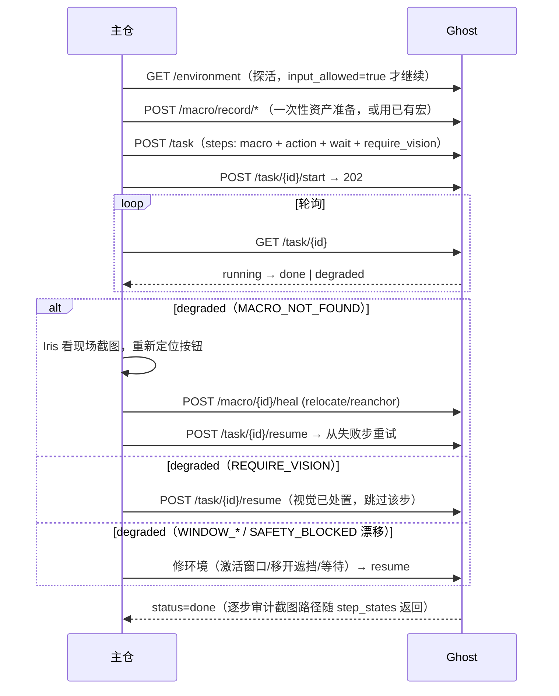

# Ghost 主仓接入指南（v0.4.1）

> **接口基址：`http://127.0.0.1:8030/api/ghost`** —— ghost 全部接口统一挂载在
> `/api/ghost/` 前缀下，主仓可在同一 8030 端口挂载自己的服务而互不冲突。
> 鉴权：所有接口需请求头 `X-Ghost-Token`（token 在 ghost 的 `.env`，首次启动自动生成）。
> 兼容性：所有 Pydantic 模型 `extra="allow"` —— 主仓多传的字段直接忽略，不会 422。

## 1. 端点总表

| 方法 | 路径 | 用途 | 关键错误 |
|---|---|---|---|
| GET | /api/ghost/health | 探活（免 token） | — |
| GET | /api/ghost/screenshot | 截图（免 token；monitor/fmt/quality/scale/save） | — |
| GET | /api/ghost/environment | **环境感知**：desktop_readable / lock_screen / uac_secure_desktop / modifiers_down / grab 近 1 分钟统计 / input_allowed | — |
| POST | /api/ghost/execute_action | 单发动作（click/type/hotkey/…；支持 source_width 坐标换算、hwnd 落点归属门禁、前台门禁） | 400 SAFETY_BLOCKED · 409 WINDOW_NOT_FOREGROUND · 503 SYSTEM_NOT_READABLE |
| GET | /api/ghost/window/list | 枚举可定位窗口 | — |
| POST | /api/ghost/macro/record/start · stop | 录制宏（stop 返回 macro_id） | — |
| POST | /api/ghost/macro/{id}/replay | 重放（dry_run / hwnd 覆盖 / allow_fallback） | 409 WINDOW_NOT_FOUND · WINDOW_OCCLUDED · MACRO_NOT_FOUND · 503 CAPTURE_FAILED |
| POST | /api/ghost/macro/{id}/heal | **视觉反哺自愈**（relocate=主仓给中心；reanchor=主仓给锚点图；base_version 乐观锁） | 409 VERSION_CONFLICT |
| POST | /api/ghost/macro/probe | 锚点匹配查询（只读，不产生输入） | 503 CAPTURE_FAILED |
| GET | /api/ghost/macro · /macro/{id} | 宏列表 / 详情（含 steps_json） | — |
| POST | /api/ghost/task | **下发任务**（步骤数组：macro/action/wait/require_vision） | 400 步骤非法 · 409 id 冲突 |
| POST | /api/ghost/task/{id}/start | 异步启动（**202 立即返回**，不阻塞主仓） | 503 SYSTEM_NOT_READABLE |
| GET | /api/ghost/task/{id} | 轮询状态（status / current_step_id / step_states / fail） | — |
| POST | /api/ghost/task/{id}/resume | degraded 处置后恢复（从失败步重试） | — |
| POST | /api/ghost/task/{id}/cancel | 中止（步骤边界安全点生效） | — |

## 2. 对接标准流程（mock_moray.py 已验证全通）



## 3. 失败处置矩阵（主仓 switch 表）

| fail_class | 含义 | 主仓动作 |
|---|---|---|
| REQUIRE_VISION | 等主仓视觉确认 | Iris 处置 → resume（该步自动跳过） |
| MACRO_NOT_FOUND | 锚点匹配失败（附 best_score + 现场截图） | Iris 重定位 → heal → resume |
| WINDOW_NOT_FOUND | 目标窗口不存在/最小化 | 重开应用 → resume（task step 需新 hwnd 时重建任务） |
| WINDOW_NOT_FOREGROUND | 目标不在前台（打字前门禁） | 激活目标窗口 → resume |
| WINDOW_OCCLUDED | 点击落点被其他窗口覆盖（落点归属门禁） | 移开遮挡 → resume |
| SAFETY_BLOCKED (drift) | 鼠标漂移超限（用户在动鼠标） | 稍候 → resume（瞬态） |
| CAPTURE_FAILED / SYSTEM_NOT_READABLE | 抓屏失败/锁屏/UAC | 轮询 /environment 至 input_allowed=true → resume |
| INTERNAL_ERROR | ghost 内部错误 | 带 run_id 报障 |

**铁律**：degraded 不是失败——是"挂起等主仓"。resume 永远从失败步重试，已完成的
步骤不会重复执行。任务注册表当前为内存态（ghost 重启后任务丢失，需重新下发）。

## 4. 一键验证

```powershell
# ghost 已启动（8030）后：
.venv\Scripts\python scripts\mock_moray.py
# 预期最后输出：== mock_moray: PASS — 主仓对接链路全通 ==
# 过程打印每次交互的完整 JSON（环境快照/任务创建/启动/轮询/degraded 处置/resume/done）
```

`mock_moray.py` 的完整业务流：环境探活 → 自建记事本录制宏（click 文件按钮）→
下发 4 步任务（macro → 中文输入 → wait → require_vision）→ 异步启动 → 轮询至
degraded（REQUIRE_VISION）→ resume → **done**（逐步结果含 run_id 与审计截图路径）。

## 5. 回归基线（v0.4.1-rc1 tag，commit d4f0172 之后的 cd7a3df/9b16259/732355b）

| 套件 | 结果 |
|---|---|
| scripts/test_v04.py | 25/25 |
| scripts/test_macro.py | 27/27 |
| scripts/test_task.py | 36/36 |
| scripts/smoke.py | 14/14 |
| scripts/mock_moray.py | PASS（对接链路全通） |
| scripts/test_v041.py | 7/7（中文输入/剪贴板还原/前台门禁） |
| 破防三轮 | r1 混乱环境 / r2 界面突变 / r3 并发 全绿 |

## 6. 安全红线（接入后继续有效）

1. 所有输入走 `controller.run_action` 同一安全管道：串行锁、Fail-Safe、前后审计截图。
2. 三道执行门禁：窗口存活（实时 rect）→ 前台门禁（type/hotkey）→ 落点归属（click）。
3. 键盘状态 try/finally 强制释放；服务启动清一次挂起键。
4. 锚点即用即裁 + TEXTURE_MIN=12 纹理下限（低纹理模板会"score=1.0 瞎点"，已封死）。
5. ghost 永不视觉推断、永不使用 recorded_center 推算点击位置——坐标只来自匹配结果。
