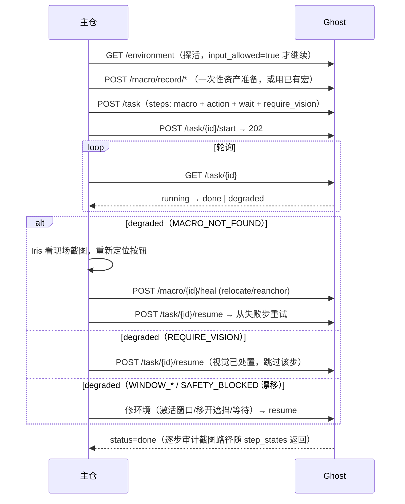

# Ghost 主仓接入指南（v0.7.1）

> **接口基址：`http://127.0.0.1:8030/api/ghost`** —— ghost 全部接口统一挂载在
> `/api/ghost/` 前缀下，主仓可在同一 8030 端口挂载自己的服务而互不冲突。
> 鉴权：所有接口需请求头 `X-Ghost-Token`（token 在 ghost 的 `.env`，首次启动自动生成）。
> 兼容性：所有 Pydantic 模型 `extra="allow"` —— 主仓多传的字段直接忽略，不会 422。
>
> **v0.7 绝对防御（破坏性变更）**：所有会产生桌面输入的请求必须携带能力令牌
> `capabilities.allowed_windows`（进程名白名单，最小权限）；窗口/键盘黑名单与
> 后置断言见下文第 6 节。旧脚本不带令牌的输入请求会被 403/400 拒绝。

## 1. 端点总表

| 方法 | 路径 | 用途 | 关键错误 |
|---|---|---|---|
| GET | /api/ghost/health | 探活（免 token） | — |
| GET | /api/ghost/screenshot | 截图（免 token；monitor/fmt/quality/scale/save） | — |
| GET | /api/ghost/environment | **环境感知**：desktop_readable / lock_screen / uac_secure_desktop / modifiers_down / grab 近 1 分钟统计 / input_allowed | — |
| POST | /api/ghost/execute_action | 单发动作（click/type/hotkey/…；支持 source_width 坐标换算、hwnd 落点归属门禁、前台门禁） | 400 SAFETY_BLOCKED · 403 HIGH_RISK_WINDOW / HIGH_RISK_INPUT / CAPABILITY_DENIED（v0.7 红线）· 409 WINDOW_NOT_FOREGROUND · 503 SYSTEM_NOT_READABLE |
| GET | /api/ghost/window/list | 枚举可定位窗口 | — |
| POST | /api/ghost/macro/record/start · stop | 录制宏（stop 返回 macro_id） | — |
| POST | /api/ghost/macro/{id}/replay | 重放（dry_run / hwnd 覆盖 / allow_fallback；**v0.7 起真实重放强制携带 capabilities，dry_run 豁免**） | 400 CAPABILITIES_REQUIRED · 409 WINDOW_NOT_FOUND · WINDOW_OCCLUDED · MACRO_NOT_FOUND · 503 CAPTURE_FAILED |
| POST | /api/ghost/macro/{id}/heal | **视觉反哺自愈**（relocate=主仓给中心；reanchor=主仓给锚点图；base_version 乐观锁） | 409 VERSION_CONFLICT |
| POST | /api/ghost/macro/probe | 锚点匹配查询（只读，不产生输入） | 503 CAPTURE_FAILED |
| GET | /api/ghost/macro · /macro/{id} | 宏列表 / 详情（含 steps_json） | — |
| POST | /api/ghost/task | **下发任务**（步骤数组：macro/action/wait/require_vision；**v0.7 起强制携带 capabilities**） | 400 步骤非法 / CAPABILITIES_REQUIRED · 409 id 冲突 |
| POST | /api/ghost/task/{id}/start | 异步启动（**202 立即返回**，不阻塞主仓） | 503 SYSTEM_NOT_READABLE |
| GET | /api/ghost/task/{id} | 轮询状态（status / current_step_id / step_states / fail） | — |
| POST | /api/ghost/task/{id}/resume | degraded 处置后恢复（从失败步重试） | — |
| POST | /api/ghost/task/{id}/cancel | 中止（步骤边界安全点生效） | — |

## 2. 对接标准流程（mock_moray.py 已验证全通）



## 3. 失败处置矩阵（主仓 switch 表）

| fail_class | 含义 | 主仓动作 |
|---|---|---|
| REQUIRE_VISION | 等主仓视觉确认 | Iris 处置 → resume（该步自动跳过） |
| MACRO_NOT_FOUND | 锚点匹配失败（附 best_score + 现场截图） | Iris 重定位 → heal → resume |
| WINDOW_NOT_FOUND | 目标窗口不存在/最小化 | 重开应用 → resume（task step 需新 hwnd 时重建任务） |
| WINDOW_NOT_FOREGROUND | 目标不在前台（打字前门禁） | 激活目标窗口 → resume |
| WINDOW_OCCLUDED | 点击落点被其他窗口覆盖（落点归属门禁） | 移开遮挡 → resume |
| CAPABILITY_DENIED（v0.7） | 目标窗口进程不在任务 capabilities 白名单 | 复核指令目标；确需操作 → 新建任务并声明正确白名单（绝不放宽现任务令牌） |
| POST_ASSERT_FAILED（v0.7） | 步骤执行成功但后置断言未过（**指令可能错误**） | Iris 复核现场截图；确认指令错误 → 取消任务并修正指令；环境滞后 → resume 重试 |
| POST_ASSERT_UNVERIFIABLE（v0.7） | 断言无法验证（OCR 缺失/抓屏失败/窗口消失） | 复核环境后 resume；字样断言建议改用 anchor_present |
| SAFETY_BLOCKED (drift) | 鼠标漂移超限（用户在动鼠标） | 稍候 → resume（瞬态） |
| CAPTURE_FAILED / SYSTEM_NOT_READABLE | 抓屏失败/锁屏/UAC | 轮询 /environment 至 input_allowed=true → resume |
| INTERNAL_ERROR | ghost 内部错误 | 带 run_id 报障 |

**铁律**：degraded 不是失败——是"挂起等主仓"。resume 永远从失败步重试，已完成的
步骤不会重复执行。任务注册表当前为内存态（ghost 重启后任务丢失，需重新下发）。

## 4. 一键验证

```powershell
# ghost 已启动（8030）后：
.venv\Scripts\python scripts\mock_moray.py
# 预期最后输出：== mock_moray: PASS — 主仓对接链路全通 ==
# 过程打印每次交互的完整 JSON（环境快照/任务创建/启动/轮询/degraded 处置/resume/done）
```

`mock_moray.py` 的完整业务流：环境探活 → 自建记事本录制宏（click 文件按钮）→
下发 4 步任务（macro → 中文输入 → wait → require_vision）→ 异步启动 → 轮询至
degraded（REQUIRE_VISION）→ resume → **done**（逐步结果含 run_id 与审计截图路径）。

## 5. 回归基线（v0.4.1-rc1 tag，commit d4f0172 之后的 cd7a3df/9b16259/732355b）

| 套件 | 结果 |
|---|---|
| scripts/test_v04.py | 25/25 |
| scripts/test_macro.py | 27/27 |
| scripts/test_task.py | 36/36 |
| scripts/smoke.py | 14/14 |
| scripts/mock_moray.py | PASS（对接链路全通） |
| scripts/test_v041.py | 7/7（中文输入/剪贴板还原/前台门禁） |
| 破防三轮 | r1 混乱环境 / r2 界面突变 / r3 并发 全绿 |

**v0.7.0 绝对防御回归（2026-10-25，本机全量重跑）**：

| 套件 | 结果 |
|---|---|
| scripts/test_v07_redline.py（新：三道门禁拦截 + post_assert） | 40/40 |
| scripts/test_v06_drag.py | 21/21 |
| scripts/test_task.py | 36/36 |
| scripts/test_v04.py | 26/26 |
| scripts/test_macro.py | 27/27 |
| scripts/test_v041.py | 7/7 |
| scripts/smoke.py | 14/14 |
| scripts/test_v06_actionlog.py | 9/9 |
| scripts/test_v06_browser.py | 14/14 |
| scripts/test_v050_platform.py | 33/33 |
| scripts/mock_moray.py | PASS（capabilities 全链路） |
| 破防三轮 | r1 3/3 · r2 6/6 · r3 16/16 |

## 6. v0.7 绝对防御（三道门禁 + 后置断言）

### 6.1 能力令牌（最小权限，强制）

所有会产生桌面输入的请求必须携带 `capabilities`：

```jsonc
// POST /task（含 action/macro 步骤时 allowed_windows 必须非空）
{"task_id": "...", "capabilities": {"allowed_windows": ["notepad.exe", "cad.exe"]},
 "steps": [{"kind": "action", "payload": {"action": "click", "x": 960, "y": 586,
                                          "hwnd": 123456, "settle_seconds": 0.2}}]}

// POST /execute_action、POST /macro/{id}/replay（真实重放；dry_run 豁免）同款字段
```

- 每个输入动作执行前，Ghost 解析目标窗口进程（显式 hwnd > 落点根窗口 > 前台窗口），
  不在白名单 → **403 CAPABILITY_DENIED**（任务内步骤 → 任务 degraded）。
- `move` 无 hwnd 不与任何窗口交互 → 豁免令牌；纯 wait/require_vision 任务允许空白名单。
- SDK：`GhostClient(allowed_windows=["notepad.exe"])` 自动随所有输入请求携带。

### 6.2 窗口/键盘黑名单（最高优先级，不可配置）

- 窗口：目标进程 ∈ {cmd.exe, powershell.exe, pwsh.exe, regedit.exe,
  WindowsTerminal.exe, conhost.exe}，或标题含 UAC/用户账户控制/格式化/删除
  → **403 HIGH_RISK_WINDOW**（任何点击与输入直接拒绝，锁前早杀 + 锁内落点复核）。
  （Win11 实证：cmd 的可见宿主是 WindowsTerminal.exe，legacy 宿主 conhost.exe，
  两者必须同列黑名单，否则"目标是 cmd"会因解析到 Terminal 而漏网。）
- 键盘：win 系组合 / ctrl+shift+esc / ctrl+alt+delete → **403 HIGH_RISK_INPUT**；
  type 文本含 `\bformat\b`、`\bshutdown\b`、`格式化`、`rm -rf`、`del /f` 等破坏性
  命令（英文按词边界，`information` 不误伤）→ 同样 403。

### 6.3 动作后置断言（防幻觉，task steps 级）

任意步骤可带 `post_assert`；步骤执行成功后核对"期望结果真的发生了"，未过 →
任务立刻 **degraded 挂起**，fail 明示"指令可能错误"，等主仓复核后 resume 重试：

```jsonc
{"kind": "action", "payload": {...},
 "post_assert": {"type": "window_title_is", "value": "保存成功"}}
```

| type | 参数 | 语义 |
|---|---|---|
| window_title_contains / window_title_is | value | 目标窗口（步骤 hwnd，缺省前台）标题包含/全等 |
| window_title_changed | — | 标题与步骤执行前基线不同 |
| anchor_present / anchor_absent | template_b64(+threshold, monitor) | cv2 模板匹配（与宏锚点同一受信原语）；字样断言推荐：主仓把"保存成功"字样裁成小图传入 |
| ocr_text_present | value(+monitor) | 屏幕 OCR 字样；本机无 OCR 引擎时如实报 POST_ASSERT_UNVERIFIABLE（不谎称通过） |

## 7. 安全红线（接入后继续有效）

1. 所有输入走 `controller.run_action` 同一安全管道：串行锁、Fail-Safe、前后审计截图。
2. 三道执行门禁：窗口存活（实时 rect）→ 前台门禁（type/hotkey）→ 落点归属（click）。
3. 键盘状态 try/finally 强制释放；服务启动清一次挂起键。
4. 锚点即用即裁 + TEXTURE_MIN=12 纹理下限（低纹理模板会"score=1.0 瞎点"，已封死）。
5. ghost 永不视觉推断、永不使用 recorded_center 推算点击位置——坐标只来自匹配结果。

## 8. v0.7.1 企业级安全（主仓视角：对接代码零改动）

1. **单实例互斥**：ghost 启动抢占命名互斥体 + 8030 端口预检，重复启动直接
   `FATAL` 退出（exit 1）。主仓"重启 ghost"流程 = 先停旧进程再启动；强杀后锁
   自动释放，无需清理。
2. **物理急停热键 Ctrl+Alt+Q**：按下 → ghost 释放全部按键鼠标并**进程退出**
   （exit 1，审计留 `estop_hotkey`）。与 HTTP `/emergency_stop`（冻结不解进程）
   是两级急停：进程死了主仓会观测到连接失败 → 按"服务不可达"处置矩阵等待重启。
3. **`GHOST_ENV=production` 输入源过滤**：动作必须来自带 `X-Ghost-Token` 的
   HTTP 调用链——主仓现有接入方式（SDK/HTTP）完全不受影响；只有"进程内 import
   ghost 代码裸调 `run_action`"这类旁路会收到 403 `SOURCE_DENIED`。
4. **结构化审计**：`data/ghost_audit.jsonl`（JSON Lines）记录每次动作的
   何时/何来源/哪个 token 指纹（sha256 前 12 位，与主仓持有的 token 可离线比对）/
   坐标明细——主仓安全团队可直接接入 SIEM；文件不含 token 原文。
5. **请求格式/必填字段无变更**：capabilities（v0.7）之后无新的破坏性变更，
   对接代码不需要修改。

## 9. v0.7.2 极限安全（新增错误码与冻结原因语义）

主仓现有接入方式（HTTP + Token）零改动；以下是需要纳入处置矩阵的**新响应语义**：

| 状态码 | error | 触发 | 主仓处置 |
|---|---|---|---|
| 403 | `FATAL_UAC_ELEVATION` | 目标是 UAC 提权弹窗（consent.exe / 「用户账户控制」标题） | **最高级告警**：说明视觉/规划把提权弹窗当成了目标；人工复核指令链，绝不重试自动点击 |
| 429 | `RATE_CIRCUIT_BREAK` | 同一动作指纹 1s 内 >10 次或连续 >50 次（AI 死循环判定） | 服务已强制冻结（`frozen_reason=rate_circuit_break`）；复核任务规划，确认后 `POST /emergency_stop/release` 解冻 |
| 408 | `ACTION_TIMEOUT` | 锁等待（`phase=lock_wait`）或执行超预算（`phase=exec_deadline`/`mid_action`） | 超时时已物理释放按键鼠标并冻结；长动作请拆步（拖拽 duration_ms 声明时长不计入预算） |

- **冻结原因可追溯**：`GET /dashboard/state`（免 token）与所有 503 `GHOST_FROZEN`
  回包均带 `frozen_reason`（`emergency_stop` / `rate_circuit_break` /
  `action_hard_timeout`），主仓据此区分"人为急停"与"系统熔断"。
- **探活永不阻塞**：`/health`、`/emergency_stop`、`/dashboard/state` 已 async 化
  ——长动作/页面加载占满执行线程时，探活与急停按钮依然即时响应；急停按钮
  优先级最高。
- **物理自救通道**：Ghost 被任务管理器强杀时，独立看门狗进程会释放全部系统
  修饰键（主仓无需感知，键盘不卡死）。
- **硬超时预算**：默认 `GHOST_ACTION_TIMEOUT=10`（秒），锁等待与执行各一段；
  拖拽的 `duration_ms` 与 `settle_seconds` 声明时长自动计入预算（+2s 固定开销
  余量），契约内合法长动作不会误杀。
