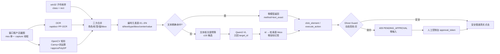

# v0.12 设计：GUI RAG 检索引擎 + Ghost Guard 动态安全门禁

> 版本：v0.12.0（2026-10-27）  
> 代码：`app/core/vl_driver.py` / `app/core/safety_gate.py` / `app/core/controller.py`
> 验收：`scripts/test_v12_gui_rag.py` **44/44**、`scripts/test_v12_heavy_gui.py` **28/28**

## 1. 问题：不要再让 VLM 回归一化坐标

v0.8–v0.9 的 `analyze(target=...)` 让 Qwen2-VL 直接输出 `bbox`（0–1000 归一化）。
实测 2B 在文本控件上可到 1px，但存在两个结构性问题：

1. **坐标幻觉**：模型可以给出一个"看起来合理"但实际不存在的框（右侧空白/整图框/1px 框）。
   现有 OCR 标签复核只能拦住"目标不存在"，拦不住"目标存在但框错位"。
2. **不必要的成本**：每次定位都要跑视觉编码；2B 在 1024 分辨率下 CPU 可达 20s+，
   GPU 也要数秒，且大屏/密集界面容易漏控件。

v0.12 改为两段式 **RAG（Retrieval-Augmented Grounding）**：

- **检索层（零模型）**：把屏幕变成带编号的候选元素表，坐标只来自像素/句柄；
- **选择层（VLM）**：模型只做选择题，返回 `{"target_id": N}`，服务端把 N 映射回
  检索表里的真实 bbox。模型**永远不生成坐标**，选错也不会点到空白处。

## 2. 架构



## 3. 检索层 `extract_ui_elements()`

### 3.1 输入与输出

```python
extract_ui_elements(monitor=1, window=None, hwnd=None, backend="auto",
                    include_icons=False, max_elements=200, annotate=False)
```

输出（坐标一律屏幕物理像素）：

```json
{
  "ok": true,
  "backend": "rag_ocr_cv",
  "elements": [
    {"id": 2, "text": "用户名", "type": "input", "label": "用户名",
     "value": "moray_user", "bbox": [484, 372, 365, 31],
     "center": [666, 387], "sources": ["cv", "native"]},
    {"id": 9, "text": "保存成功", "type": "button",
     "bbox": [776, 607, 131, 54], "center": [841, 634],
     "sources": ["cv", "native"]}
  ],
  "count": 13,
  "guard": {"verdict": "pending_approval", "dangerous_ids": [10, 11, 12]}
}
```

### 3.2 三路信源与合并规则

| 信源 | 提供 | 局限 |
|---|---|---|
| OCR（rapidocr） | 可见文本 + 行 bbox + score | 不知道按钮/输入框；中文标签与值可能连读 |
| OpenCV | 按钮/输入框的矩形边框（fill≥0.85，h≥24） | 无边框扁平控件/图标检测不到 |
| win32 子件 | class（Button/Edit/TkChild）+ 精确 rect | Tk 的 Win32 text 恒为空（本机实证） |

合并：

1. 原生子件作为种子；同位置 CV 矩形（IoU≥0.45）精修 bbox（Tk 实测从 364x30
   修正到 365x31，与 Tk 自报误差 ≤1px）；
2. 未匹配的 CV 矩形按"文本对齐 + 长宽比"分类：
   - `aspect ≥ 3.2` 且文本左对齐/无文本 → `input`
   - 小尺寸且文本不居中 → `checkbox`
   - 其余 → `button`
3. OCR 行贴附：
   - 输入框：取同水平带、右边缘在框左侧 260px 内的最近 OCR 行作为标签；
     框内文本作为值。`用户名moray_user` 按 CJK→ASCII 边界拆成
     `label=用户名 / value=moray_user`；纯中文连读（`备注像素级自动化`）按
     输入框左边界占整行像素比例估切分点。
   - 按钮/复选框：框内 OCR 行作为标签；未消费的 OCR 行成为 `text` 元素；
   - 被控件严格包住的 `text` 元素丢弃，防止标签重复。
4. 阅读顺序：`band = median(height)*0.6`，按 `(y//band, x)` 排序后编号 1..N。
5. `include_icons=True` 时追加 CV 图标候选（无文本工具条/画图软件）。

### 3.3 为什么只裁剪客户区

`GetClientRect + ClientToScreen` 裁掉标题栏/边框：OCR 不会读到窗口标题和
口/×/— 控件，bbox 与 win32 子件天然同一坐标系，也避免"窗口标题含删除 →
所有元素被误标"。

### 3.4 缓存

`ground_target` 默认使用 2s TTL 的元素缓存（`GHOST_RAG_CACHE_SECONDS`）：
连续选号不必重复 OCR（本机 660x540 暖机 ~1.4s）；任何动作执行后
`controller.run_action` 的 `finally` 立即 `invalidate_rag_cache()`，绝不把旧
界面元素用于新动作。`/vl/elements` 永远新鲜，不走缓存。

## 4. 选择层 `ground_target()`

### 4.1 策略

| strategy | 行为 |
|---|---|
| `auto`（默认） | 唯一精确/包含文本命中 → 零模型；否则 VLM 选号 |
| `vlm` | 强制 VLM 选号（准确率验收用；失败不回落文本匹配） |
| `text` | 只用确定性匹配；多命中 409，绝不猜 |
| `hybrid` | VLM 优先；无效/低置信时回落唯一文本匹配 |

`match` 支持 `auto|exact|contains`；`use_image` 为 `None` 时 auto：
图标候选/全部无文本候选才附编号截图，否则纯文本目录（2B 目录选号 ~0.4s）。

### 4.2 候选预筛（RAG retrieval）

对每个元素/标签/值做归一化（去空白/标点、lower）：

- 精确相等 100；query 包含在元素文本 85；元素文本包含在 query 65；
- 英文/数字词重叠按 Jaccard×40；
- 类型提示（"输入框/按钮/勾选/图标/文字"）+20；
- 无标签图标保留极低权重，避免被全部滤掉；
- 取 top `GHOST_RAG_MAX_CANDIDATES`（默认 16）。

### 4.3 VLM prompt（实测最稳的一版）

```text
System: You are a precise GUI element matcher. Match the target string to the
element with the same label. Reply ONLY {"target_id": <number>}. If no element
matches, reply {"target_id": 0}. Never invent an id that is not in the list.

User:
Elements:
1. [button] 登录
2. [button] 取消
3. [button] 保存成功
4. [button] 删除账户
...
Target label: 保存成功
Answer JSON:
```

关键点：

- **不要让模型输出坐标**，也不要让它输出"元素描述"；只回 id。
- 目录带类型与输入值，模型能区分"登录"与"退出登录"、"密码"输入框与密码标签。
- `temperature=0`、`max_tokens=48`、`response_format=json_object`。
- 解析兼容 `target_id/id/index/number/element_id` 与 `button_3` 这类字符串；
  越界 id 视为无效，宁可 404 不猜。
- 文本选号无效/低置信时，自动带编号截图重试一次（`vlm_image`）。

## 5. Ghost Guard（动态安全门禁）

### 5.1 规则

`safety_gate.dynamic_guard(texts)` 纯文本判定，覆盖：

| 类别 | 词（节选） |
|---|---|
| payment | 转账/付款/支付/汇款/打款/收款/transfer/pay/payment |
| deletion | 删除/移除/格式化/清空/抹除/销毁/卸载/重置/恢复出厂/delete/remove/wipe/uninstall/reset |
| session | 退出登录/注销/登出/退出账号/logout/log out/sign out |
| system | shutdown/poweroff/diskpart/reg delete/rm -rf/format c: |

- 中文按去空白后的子串（OCR 常把「删除」读成「删 除」）；
- 英文按词边界（`display` 不误伤 `pay`，`information` 不误伤 `format`）；
- 剔除安全复合词「删除线」；
- **刻意不把裸英文 `format` 列入**：Paint/Word 功能区「Format/格式」是正常排版，
  误杀会阻断重型实战；中文「格式化」与 `format c:` 仍拦截。
- 返回 `verdict/requires_approval/hits/categories/version`。

### 5.2 原生点击

在 `_run_locked_action` 里、**`moveTo` 之前**：

1. 用已经抓好的 before 截图（零额外抓屏）；
2. `vl_driver.ocr_control_at()` 在落点周围 440x180 找 CV 矩形，取**包含落点的
   最小矩形**，只 OCR 矩形内部（避免把相邻「删除账户」读成当前「取消」）；
3. 无边框控件回退 180x72 紧裁剪；
4. 命中 → `PendingApprovalError`（409），动作零输入，物理鼠标不动；
5. 未命中 → 正常执行，响应带 `visual_guard.verdict=allow` 与 OCR 取证。

### 5.3 审批

- `GHOST_APPROVAL_TOKEN` 未配置：危险动作永久 `PENDING_APPROVAL`。
- 配置后：payload `approval_token` 与配置常量时间比较，匹配才放行；
  审计落 `guard_approved`，响应 `visual_guard.verdict=approved`。
- **Agent/MCP 进程不读取该令牌**：`click_element` 遇到危险目标直接返回
  `PENDING_APPROVAL`，只能由人工控制台带令牌重新发起。审批令牌不是
  "AI 可自签"的开关。

### 5.4 fail-closed

`GHOST_GUARD_FAIL_CLOSED=true`（默认）：OCR 引擎不可用 → 503
`VISUAL_GUARD_UNAVAILABLE`，绝不在"看不见"时盲点。需要显式降级时设 false，
响应 `visual_guard.verdict=unavailable` 并审计 `guard_unavailable`。

### 5.5 CDP 浏览器

`browser_driver` 在 click/dblclick/press-with-selector 前取目标 DOM 文本
（inner_text / input value / aria-label / title / alt），同一
`dynamic_guard` 判定；命中 → 409 `PENDING_APPROVAL`，`source=cdp_dom`。
支持同样的 `approval_token`，审计 `guard_pending/guard_approved`。
新增只读 `op=screenshot`（页面级截图，不产生输入）供录屏/审计。

## 6. 准确率与性能（本机 2026-10-27）

### 6.1 检索准确率（10 个真实控件：3 输入框/1 复选框/6 按钮）

| 指标 | 结果 |
|---|---|
| 召回（按标签） | **10/10** |
| 控件级精确率 | **10/10**（无多余控制元素） |
| bbox IoU | 最小 **0.965**，平均 **0.974**（阈值 0.75） |
| bbox 中心误差 | 最大 **0.5px**，平均 **0.5px** |
| 类型 | 10/10（input/button/checkbox） |
| 输入值分离 | 用户名 `moray_user` / 密码空 / 备注 `像素级自动化` |
| 二次抽取稳定性 | 标签+bbox 完全一致（13 元素） |
| 危险元素标注 | 删除账户/转账/退出登录 → ids 10/11/12，categories 三类齐全 |

### 6.2 选号准确率（Qwen2-VL-2B，GPU）

| 指标 | 结果 |
|---|---|
| 10 个标签 VLM 选号 | **10/10** |
| 选中 bbox 与检索表逐字节一致 | **10/10**（零坐标幻觉） |
| 选中 bbox 与真实控件 IoU≥0.75 | **10/10** |
| 「登录 vs 退出登录」消歧 | 选中「登录」 |
| 模糊目标「保存」「密码框」 | 保存成功 / 密码 |
| 首次选号（含模型加载） | 2.6–4.7s |
| 热路径（2s 元素缓存命中 + 目录选号） | 平均 **692ms**（min 367ms） |
| 纯文本目录 VLM 调用 | ~0.4s/次 |

### 6.3 检索耗时

- 冷启动（OCR 引擎首次加载）：3.5s；
- 暖机 660x540 客户区：~1.4s（OCR 占 1.3s+，CV 4ms，合并 2–9ms）；
- 2s 缓存命中：~0ms（仅 VLM 选号）。

> 说明：1.4s 主要是 rapidocr 的 det+rec CPU 推理。若追求更低延迟，可把
> OCR 引擎常驻/换 GPU onnxruntime，或对已知窗口使用 native 文本直读；
> 当前设计优先"零坐标幻觉 + 通用性"。

## 7. 重型实战（GIF/MP4）

### 7.1 原生 Tk 表单（`scripts/test_v12_heavy_gui.py` A 段）

自建 10 控件 Tk 表单（用户名/密码/备注/记住我/登录/取消/保存成功/删除账户/转账/退出登录）：

1. `/vl/elements` 检索 13 元素，危险元素 3 个；
2. RAG 选号「用户名」→ 点击 → Ctrl+A → 键入 `ghost_agent`；
3. RAG 选号「备注」→ 点击 → 键入 `gui-rag-ok`；
4. RAG 选号「保存成功」→ 点击 → 表单读回输入框，标题回显
   `-BTN:保存成功|user=ghost_agent|note=gui-rag-ok`；
5. 点击「删除账户」→ **409 PENDING_APPROVAL**，标题不变；
6. 人工审批令牌 → **200**，标题 `-BTN:DANGER-1`，状态栏「已点击 删除账户」。

产物：

- [gui_rag_form_guard.gif](assets/gui_rag_form_guard.gif)（4.5MB，620x589，带阶段字幕）
- `docs/assets/gui_rag_form_guard.mp4`
- `docs/assets/gui_rag_form_final.png`

### 7.2 本地浏览器表单（B 段）

自建 Edge（headless=new + 临时 profile）+ 本地 HTML 表单（姓名/邮箱/备注 +
提交/清空/删除记录/退出登录），**绝不连接真实账户/微信**：

1. CDP fill 三字段 → 点击提交 → 页面 title `SUBMITTED:张三/ghost@example.local`；
2. 点击「删除记录」→ **409 PENDING_APPROVAL**（`source=cdp_dom`），title 仍 SUBMITTED；
3. 人工审批 → 200，title `DELETED`，状态「记录已删除」；
4. 点击「退出登录」→ 409；审批 → 200，title `LOGOUT`。

产物：

- [browser_form_guard.gif](assets/browser_form_guard.gif)（466KB，660x495，页面级 CDP 截图）
- `docs/assets/browser_form_guard.mp4`
- `docs/assets/browser_form_final.png`

> 为什么浏览器用页面级截图而不是桌面录屏：本机 Edge 临时 profile 会弹
> "同步你的浏览数据"系统对话框，盖住页面；`--headless=new` + Playwright
> `page.screenshot()` 只录网页内容，证据更干净。原生 Tk 段仍用真实桌面
> 3fps 抓屏。

## 8. 契约

### 8.1 HTTP

- `POST /api/ghost/vl/elements` → 元素表（见 §3.1），需 `X-Ghost-Token`；
- `POST /api/ghost/vl/ground` → `target_id/element/method/candidates`，需 token；
- 原生点击：`/execute_action` 命中危险词 → 409 `PENDING_APPROVAL`；
- 浏览器点击：`/browser/action` 命中危险 DOM 文本 → 409 `PENDING_APPROVAL`；
- `/health` 增加 `guard` 与 `rag` 配置回显（绝不含审批令牌）。

### 8.2 MCP

5 个 Tools 不变。`click_element` 先调 `/vl/ground`，成功则用返回的
`element.center` 走安全管道；响应带 `target_id` / `method`。危险目标在 MCP 层
直接返回 `PENDING_APPROVAL`，不移动鼠标。RAG 未命中/后端不可用时回落到
旧 analyze/target/hybrid 路径。

### 8.3 错误码

| 错误 | 状态 | 含义 |
|---|---|---|
| `PENDING_APPROVAL` | 409 | 动态高危词命中，动作未执行；需人工审批 |
| `VISUAL_GUARD_UNAVAILABLE` | 503 | OCR 不可用且 fail-closed |
| `VL_ELEMENT_NOT_FOUND` | 404 | 元素/选号不存在或越界 |
| `VL_AMBIGUOUS` | 409 | 文本匹配多命中且未启用 VLM 消歧 |
| `RAG selection failed` | 400/503 | VLM 推理失败/后端不可用 |

## 9. 测试矩阵

| 脚本 | 结果 | 覆盖 |
|---|---|---|
| `test_v12_gui_rag.py` | **44/44** | 检索精度/类型/输入值/编号/危险标注/截图/稳定性；VLM 10/10/消歧/模糊/延迟；Guard 拦截/错误令牌/审批/审计；MCP 全链 |
| `test_v12_heavy_gui.py` | **28/28** | Tk 表单 RAG 填表+保存+Guard；本地浏览器 CDP 填表+Guard；GIF/MP4/PNG；Edge 清理 |
| `test_v08_mcp_vl.py` | 21/21 | MCP Tools / analyze / RAG click / type / task / 门禁 |
| `test_v08_paint_precision.py` | 11/11 | Paint 控件 OCR / 拖拽笔迹像素精度 |
| `test_v06_browser.py` | 14/14 | CDP 接管 / fill/click / scroll / 定位纪律 / 冻结 |
| `test_v072_extreme.py` | 40/40 | UAC/看门狗/熔断/硬超时 |
| `test_v09_draw_trajectory.py` | 31/31 | 绘制资产/Paint 端到端 |

合计新增 72 checks；受影响回归 117 checks 全绿。

## 10. 设计取舍与已知限制

- **只支持原生窗口**：`extract_ui_elements` 遇到 URL/Edge/Chrome 窗口会拒绝，
  网页走 CDP；浏览器有独立的 DOM Guard。
- **无边框扁平控件**：CV 抓不到边框，只能靠 OCR 文本成为 `text` 元素；
  图标工具条需 `include_icons` 或旧 hybrid 路径。
- **OCR 连读/漏读**：标签与值可能粘连；已用 CJK→ASCII/比例切分缓解，但
  复杂排版仍可能不准。测试用 10 控件验证，不等于任意界面 100%。
- **2B 语义边界**：目录选择题在 10 标签上 10/10，但复杂/长目录仍可能选错；
  候选预筛 + 编号截图重试 + 404 不猜是兜底，不是"2B 万能"。
- **Guard 的 false positive/negative**：只扫可见标签；OCR 误读可能漏拦，
  也可能把正常文本误判为高危（宁可错杀）。`GHOST_GUARD=off` 可关闭，
  但结构门禁（窗口黑名单/能力令牌/熔断/硬超时）不受影响。
- **拖拽起点不做过 OCR Guard**：`drag` 不经过点击 Guard（绘图性能）；
  若需要覆盖"从危险按钮拖出"，应额外做起点控件识别。
- **审批令牌是静态共享密钥**：没有 per-action nonce/过期时间；安全边界依赖
  令牌保密 + 审计 + 人工控制台。后续可加一次性 approval_id + TTL。
- **页面级浏览器录屏**：GIF 是 CDP 页面截图，不含浏览器 chrome/同步弹窗；
  原生桌面录屏仍由 Tk 段覆盖。

## 11. 复现

```powershell
# 精度 + Guard + MCP（44 checks）
.venv\Scripts\python scripts\test_v12_gui_rag.py

# 重型实战 + GIF/MP4（28 checks；需要本机 Edge）
.venv\Scripts\python scripts\test_v12_heavy_gui.py

# 受影响的回归
.venv\Scripts\python scripts\test_v08_mcp_vl.py
.venv\Scripts\python scripts\test_v08_paint_precision.py
.venv\Scripts\python scripts\test_v072_extreme.py
.venv\Scripts\python scripts\test_v09_draw_trajectory.py

# 浏览器 CDP 回归需先启动服务
.\start.ps1
.venv\Scripts\python scripts\test_v06_browser.py
```

环境变量见 [`.env.example`](../.env.example) 的 v0.12 段。
