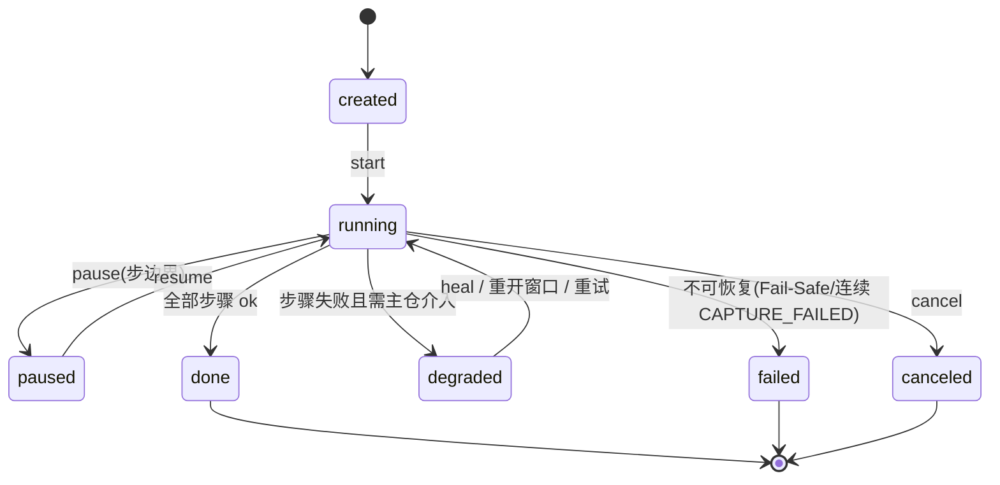

# v0.4 设计草案：主仓接入与失败降级

> **文档来源声明**：本稿由 ghost 侧基于 v0.2~v0.3 已落地代码与验收经验**新起草**，
> 作为讨论底稿。如主仓侧已有设计原稿，以原稿为准，本文对齐后归档。
> 现状基线：commit `5510e02`（含键盘状态保护 v0.3.1）。

## 1. 角色与信任边界

```
┌─────────────────────┐         本机 HTTP + X-Ghost-Token        ┌──────────────────┐
│   主仓 (D:\MoRay)    │ ──────────────────────────────────────► │  ghost (本服务)   │
│  任务编排 / Iris 视觉 │ ◄────────────────────────────────────── │  桌面执行 / 审计   │
└─────────────────────┘        结构化失败报告 + 环境状态            └──────────────────┘
```

- **主仓**决定"做什么"（视觉理解、任务规划、失败处置）；**ghost** 只回答
  "怎么做、做了没有、为什么没做成"。ghost 永远不做视觉推断、不猜坐标。
- 所有输入动作走 `controller.run_action` 同一安全管道（串行锁 / Fail-Safe /
  前后审计截图 / 键盘状态保护）；所有接口强校验 `X-Ghost-Token`。
- 跨任务的写接口（heal / task 状态变更）启用 **HMAC Intent Token + nonce 防重放**
  （v0.2 已实现，默认关闭，v0.4 打开）。

## 2. 任务生命周期（新增 /task/*）

### 2.1 数据模型

```jsonc
{
  "task_id": "t_...",                    // 主仓生成
  "goal": "在记事本里保存一份 hello.txt",  // 可选，供审计
  "steps": [                             // 有序步骤
    {"step_id": 1, "kind": "macro",      "macro_id": "m_...",  "hwnd": 123},
    {"step_id": 2, "kind": "action",     "payload": { /* execute_action 同构 */ }},
    {"step_id": 3, "kind": "wait",       "ms": 1500},
    {"step_id": 4, "kind": "require_vision", "prompt": "确认对话框已出现"}
  ],
  "status": "created",                   // 状态机见 2.2
  "created_at": "...", "updated_at": "..."
}
```

### 2.2 API Schema

| 方法 | 路径 | 请求体 | 响应 | 鉴权 |
|---|---|---|---|---|
| POST | /task | 上述模型（task_id 可省略由 ghost 生成） | 201 `{task_id, status:"created"}` | token |
| GET | /task/{task_id} | — | 完整任务 + 步骤级状态 | token |
| POST | /task/{task_id}/start | — | 202 `{status:"running"}`（后台执行，GET 轮询） | token |
| POST | /task/{task_id}/pause | — | 200（当前步完成后挂起） | token |
| POST | /task/{task_id}/resume | — | 200 | token |
| POST | /task/{task_id}/cancel | — | 200（安全点中止，不切断进行中的输入） | token |

### 2.3 状态机



- `degraded` 是 v0.4 的核心新增态：任务没有失败，只是**需要主仓介入**（视觉 /
  重开窗口 / 改环境）。ghost 把失败步骤与现场证据（截图、best_score、occluder）
  挂在任务上，等主仓处置后 resume。
- 步骤级状态：`pending → executing → done | failed(reason)`；失败步骤记录
  `fail_class`（第 5 节的分类），重试由主仓通过 resume 驱动，ghost 不自动重试
  （除抓屏类已内置的 3 次尝试）。

## 3. 视觉反哺 Heal（/macro/{id}/heal 从 501 转正）

### 3.1 语义

主仓 Iris 看过现场截图后，**以视觉结果为准回填锚点**；ghost 不做任何视觉推断。
触发方就是重放失败的响应：`409 MACRO_NOT_FOUND {best_score, fail_screenshot_path, run_id}`。

### 3.2 API Schema

```jsonc
POST /macro/{macro_id}/heal
{
  "task_id": "t_...",
  "step_id": 2,
  "reason": "MACRO_NOT_FOUND",            // 原样回传重放失败响应里的 error
  "mode": "relocate",                      // relocate | reanchor
  "vision": {
    "found": true,
    "center": [x, y],                      // 全屏物理像素（Iris 认定的按钮新位置）
    "crop": "<base64 PNG>"                 // mode=reanchor 时必填；relocate 可省
  }
}
→ 200 {"ok": true, "healed": true, "macro_id": "...", "version": 3, "step_id": 2}
→ 400 vision 缺失 / center 越界；409 version 冲突（乐观锁，见 3.3）
```

- **relocate**：主仓只给新中心 → ghost 以该中心在**当前屏**重裁 64x64 作为新锚点
  （即用即裁，规避 Mica 重混色问题），替换该步 `image_b64`。
- **reanchor**：主仓直接给新锚点图（它自己裁好的）→ ghost 校验可解码、非退化
  （std>0，沿用现有防线）后替换。
- 两者的 `center` 都必须落在录制时的 monitor 范围内，否则 400。

### 3.3 版本与审计

- `macros.version` 每次 heal +1（乐观锁：请求带 `base_version`，不匹配 → 409，
  防止两个主仓实例并发 heal）。
- heal 全量审计：谁（task_id）、何时、step_id、旧锚点哈希 → 新锚点哈希，写入
  `macro_runs`（status='healed'）或新增 `macro_heal_log` 表。
- 锚点即用即裁原则不变：heal 只是替换锚点数据，重放时的匹配流程不变。

## 4. 环境状态感知（GET /environment）

```jsonc
GET /environment
{
  "desktop_readable": true,          // 最近 N 次 grab 全部成功（滑动窗口）
  "lock_screen": false,              // GetForegroundWindow()==0 判定
  "uac_secure_desktop": false,       // fg==0 且 BitBlt 连续失败
  "grab_failures_1min": 0,           // capture 线程的失败计数
  "modifiers_stuck": [],             // 启动时/巡检时发现的残留修饰键
  "cursor": [x, y],
  "monitors": [{"index":1,"left":0,"top":0,"width":2560,"height":1600,"primary":true}],
  "elapsed_ms": 3
}
```

- 实现基础全部已存在：capture 线程的失败自愈计数、`GetForegroundWindow()`==0 的
  锁屏/UAC 判定、`release_all_modifiers()`（启动时清挂起键，可扩展为巡检对比）。
- **ghost 侧用法**：replay/task 执行前自检 `desktop_readable`，false → 直接
  503 `SYSTEM_NOT_READABLE`，绝不执行输入（比让每步撞 BitBlt 失败更快更干净）。
- **主仓侧用法**：派发前轮询；`uac_secure_desktop=true` 时静默等待，不要重试动作。

## 5. 失败降级总图

### 5.1 处置矩阵（左列全部已在 v0.3 实现并验收）

| 失败类 | HTTP | ghost 行为 | 主仓处置 |
|---|---|---|---|
| `WINDOW_NOT_FOUND` | 409 | 终止宏，run 落库 | 重开应用 → replay 带 `hwnd` 覆盖（已支持） |
| `WINDOW_NOT_FOREGROUND` | 409 | 拒绝 typing（前台门禁） | 激活目标窗口 → resume |
| `WINDOW_OCCLUDED` | 409 | 拒绝点击（落点归属门禁） | 移开遮挡 → resume |
| `MACRO_NOT_FOUND` | 409 | 终止宏 + best_score + 现场截图 | Iris 看屏 → **heal** → replay |
| `CAPTURE_FAILED` | 503 | 已内部重试 3 次 | 等待环境恢复 → 重试（参考 /environment） |
| `FAIL_SAFE_TRIGGERED` | 409 | 全部中止 + 现场截图 | 人工确认后继续 |
| `SYSTEM_NOT_READABLE`（v0.4 新增） | 503 | 执行前自检拒绝 | 等 UAC/锁屏退场 |

### 5.2 核心流程图

```mermaid
flowchart TD
    A[主仓发起 replay / task.start] --> B{ghost 环境自检}
    B -- 不可读 --> C[503 SYSTEM_NOT_READABLE] --> W[主仓等待 /environment]
    W --> A
    B -- 可读 --> D[逐步执行: 窗口存活→前台门禁→ROI匹配→落点归属→安全管道]
    D -->|成功| E[步骤 done, 下一步]
    D -->|MACRO_NOT_FOUND| F[409 + best_score + 现场截图, 任务→degraded]
    F --> G[主仓 Iris 看屏]
    G -->|认出按钮| H[POST /macro/{id}/heal relocate/reanchor]
    H --> A
    G -->|认不出| I[人工/换策略]
    D -->|WINDOW_*| J[409 + 证据, 任务→degraded]
    J --> K[主仓重开窗口/激活/移开遮挡]
    K --> A
    D -->|CAPTURE_FAILED| L[503, 任务→degraded]
    L --> M[主仓轮询 /environment 至可读]
    M --> A
```

## 6. 安全红线（全部沿用，v0.4 不放松）

1. 执行动作三道门：窗口存活（实时 rect）→ 前台门禁（typing）→ 落点归属（click）。
2. 键盘状态保护：所有 keyDown/hotkey/write 包 try...finally 强制释放修饰键；
   服务启动时清理一次（v0.3.1，commit `5510e02`）。
3. 审计无盲点：动作前后截图落盘；失败现场截图；heal 全量审计。
4. 测试纪律：只操作自建窗口（hwnd 差集）、前台门禁、证据链。
5. 锚点即用即裁；ghost 永不视觉推断、永不使用 recorded_center 推算点击位置。

## 7. 里程碑

| 里程碑 | 内容 | 依赖 |
|---|---|---|
| M1 | 键盘状态保护（已完成 `5510e02`） | — |
| M2 | GET /environment + replay 前自检（**已完成 `6d4a68a`**；解锁态验收 3/3，锁屏态验收待用户配合按 Win+L 后 curl 对照） | capture 失败计数暴露 |
| M3 | /task 生命周期（**已完成 `9b16259`**：create/start(202 异步)/GET/resume/cancel + degraded 挂起 + 失败步重试；验收 test_task 36/36） | M2 |
| M4 | heal 转正（**代码已完成 `6d4a68a`**：relocate/reanchor + 乐观锁 + macro_heal_log；验收 25/25） | 主仓 Iris 就绪 |
| M5 | Intent Token 全面启用（写接口 nonce 防重放） | 主仓接入 |
| M6 | dxcam 抓屏（性能：grab 106ms → ~5ms） | 独立，可并行 |
| backlog | 任务持久化（当前注册表为内存态，服务重启即失） | M3 |
